<p align="center">
  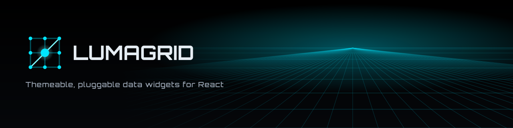
</p>

<p align="center"><strong>Themeable, pluggable data widgets for React</strong></p>

## What it is

Lumagrid is a layered React + TypeScript library for data visualization widgets over tabular, hierarchical, geographic and time-series data. Draw with the built-in SVG charts, or plug in your own renderer.

- Eleven native chart types: bar, line, pie, scatter, area, column, heatmap, data table, tree view, choropleth and force graph
- D3, Recharts and Nivo adapters that turn any of those libraries into a view
- A transform layer (`flatten`, `aggregate`, `pivot`, `groupBy`, `geoNormalize`) with no React dependency
- Light and dark themes, plus your own through `ThemeProvider`
- The `ChartPlugin` contract for writing a renderer from scratch, and a conformance kit (`lumagrid/testing`) that checks it
- Strict TypeScript types, with every export tagged `@public` or `@experimental`

## Install

```bash
npm install lumagrid react react-dom
# optional adapter peers, only for the libraries you use
npm install d3 recharts @nivo/bar
```

> **Note:** Lumagrid is pre-1.0. Minor versions may change the API until 1.0; see [docs/STABILITY.md](docs/STABILITY.md) and [docs/RELEASE-PLAN.md](docs/RELEASE-PLAN.md).

## Quickstart

<!-- snippet: hero#hero -->

```tsx
import { ThemeProvider, WidgetContainer, ViewSwitcher, registerPlugin, type TransformedData } from 'lumagrid';
import { nativeBarPlugin } from 'lumagrid/viz';
registerPlugin(nativeBarPlugin);
const data: TransformedData = {
  rows: [{ region: 'North', revenue: 12000 }, { region: 'South', revenue: 14200 }],
  fields: [{ key: 'region', type: 'string' }, { key: 'revenue', type: 'number' }],
};
const views = [{ id: 'bar', config: { valueField: 'revenue', labelField: 'region' } }];
export const Example = () => (
  <ThemeProvider theme="dark">
    <WidgetContainer data={data} title="Revenue" width={480} height={300}>
      {(d, w, h) => <ViewSwitcher views={views} data={d} width={w} height={h} />}
    </WidgetContainer>
  </ThemeProvider>
);
```

## Charts

| | | | |
|:-:|:-:|:-:|:-:|
| 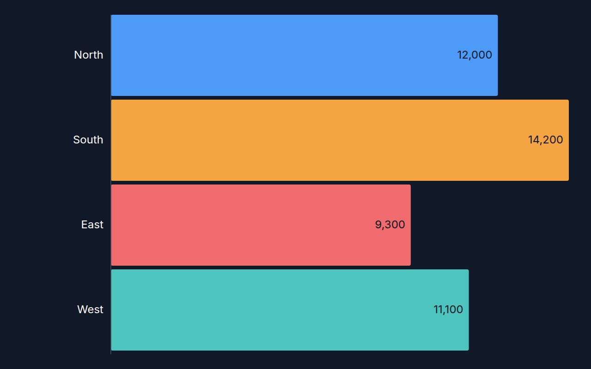<br>Bar | 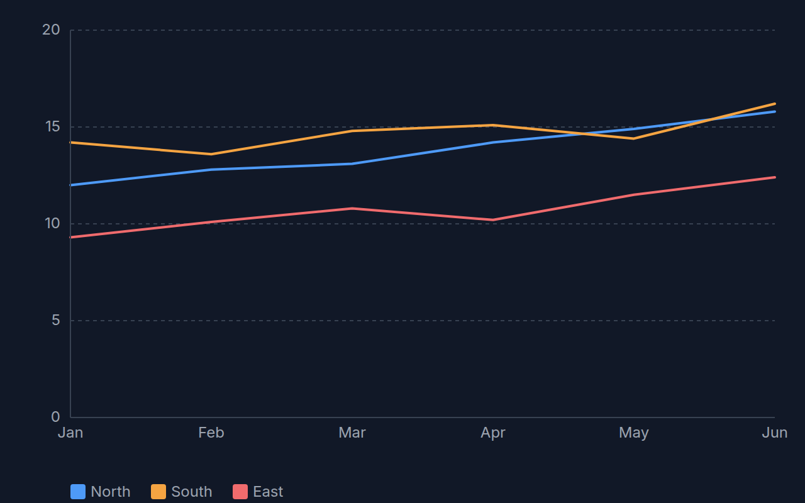<br>Line | 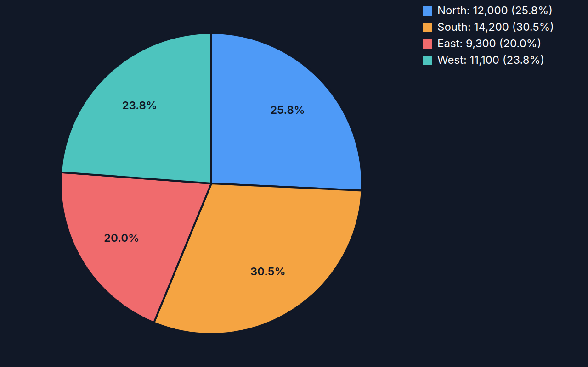<br>Pie | 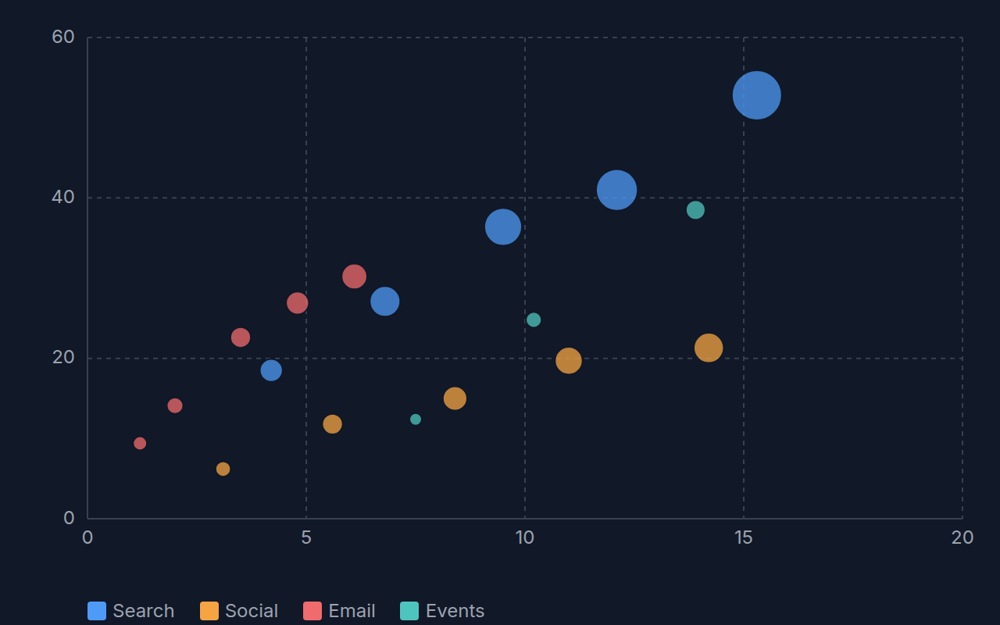<br>Scatter |
| 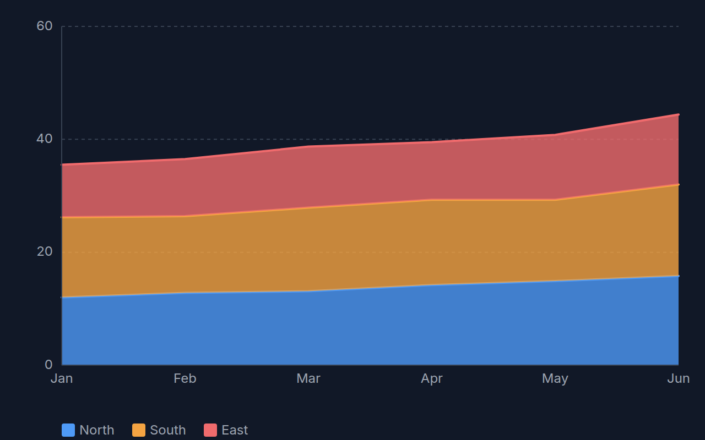<br>Area | 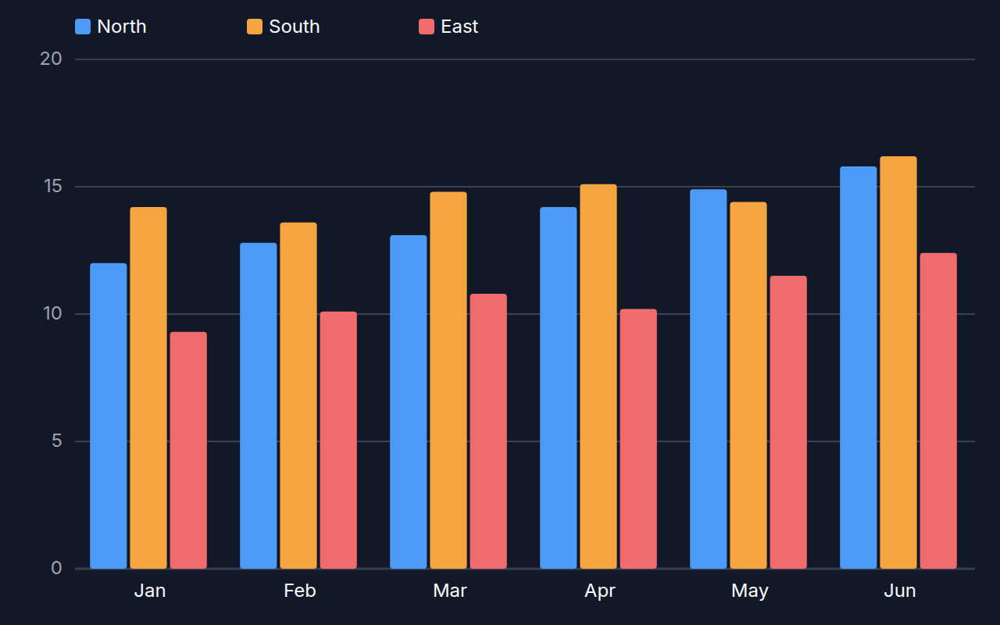<br>Column | 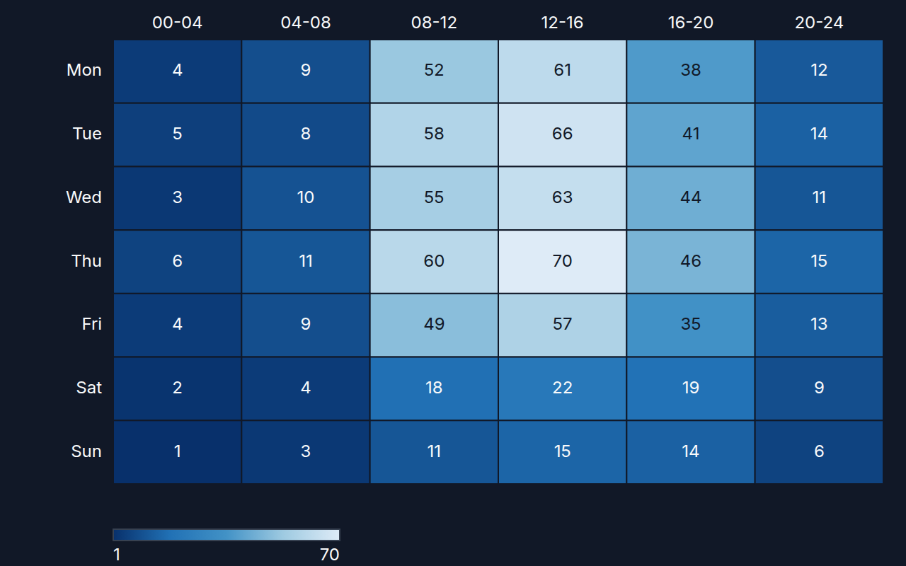<br>Heatmap | 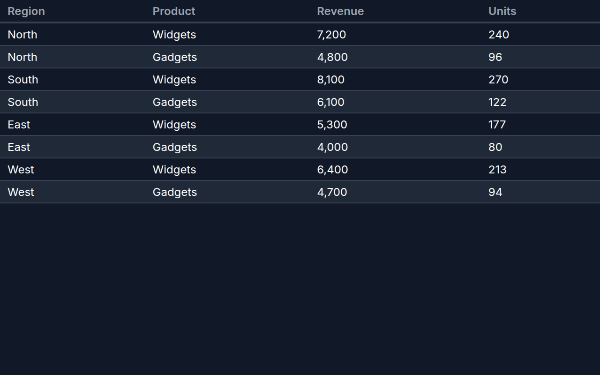<br>Data table |
| 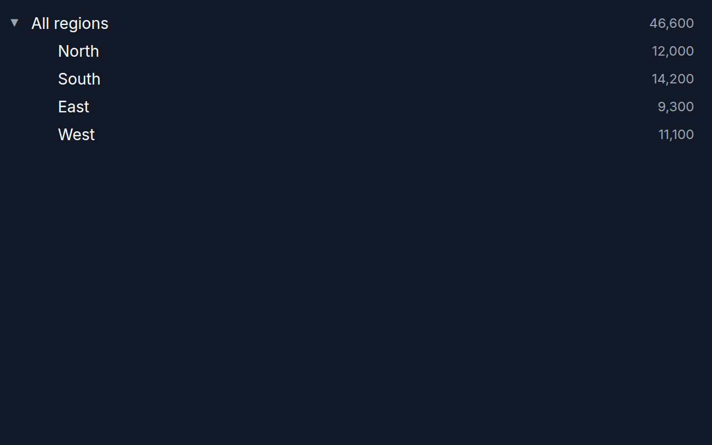<br>Tree view | 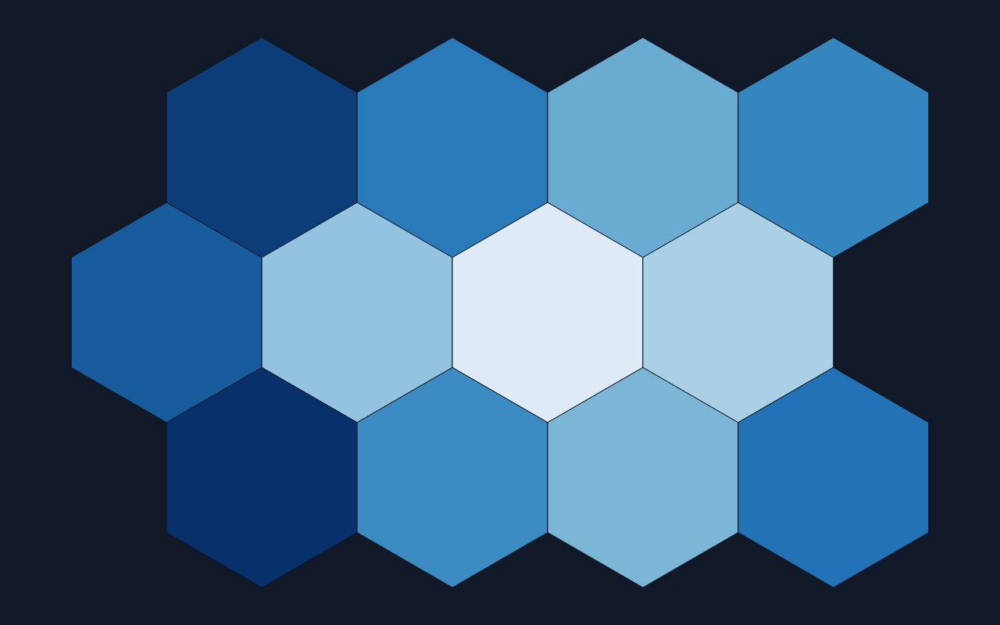<br>Choropleth | 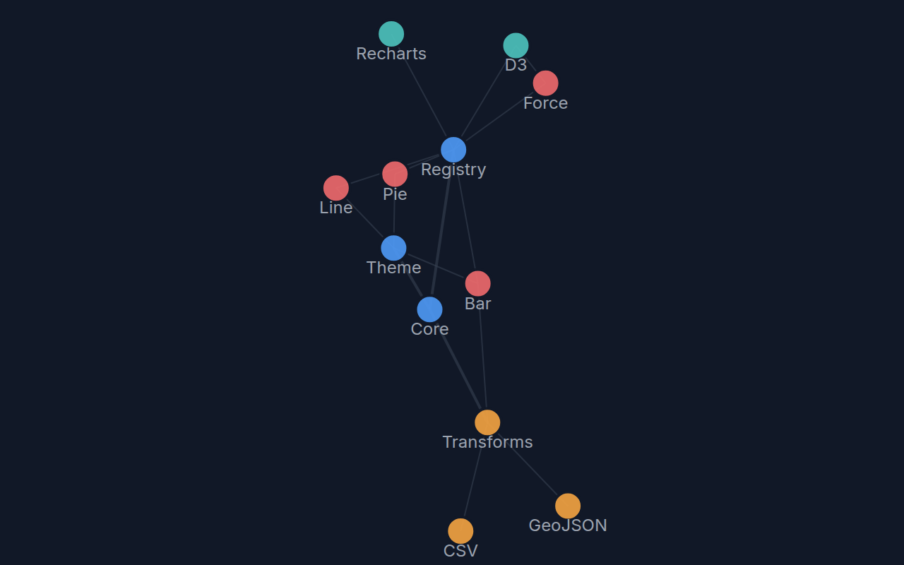<br>Force graph |  |

See the [live Examples](https://bsommers.github.io/lumagrid/#examples) (dashboard, CSV to chart, engine switcher, theme playground) and the [gallery](https://bsommers.github.io/lumagrid/#gallery).

## Why Lumagrid

Lumagrid is not trying to out-chart anyone. Its angle is the seam: a chart is a plugin, so you can swap the engine under a view and prove a new engine behaves.

| | Lumagrid | Recharts | Nivo | Raw D3 |
|---|---|---|---|---|
| Engine-swappable plugins | Yes: one `ChartPlugin` contract; native, D3, Recharts and Nivo renderers all plug in | No: it is the engine | No: it is the engine | No: it is the engine |
| Conformance kit | Yes: `lumagrid/testing`, 8 checks you can run on your own plugin | No | No | No |
| Built-in keyboard and screen-reader support | Every native chart has an accessible name, and the interactive ones are keyboard navigable; checked by the kit | Partial (keyboard layer, labels mostly up to you) | Partial (varies by chart, mostly up to you) | None: you build it |
| Number of charts | 11 native, plus anything you wrap | Far more, with many options per chart | Far more, a large catalog | Unlimited, but you write each one |
| Maturity | Pre-1.0 (0.x), new, small community | Mature, widely used, large community | Mature, widely used | The reference standard |

**Be honest about the trade:** Recharts, Nivo and D3 have far more chart types, richer options, much larger communities and years of production use. Lumagrid has 11 charts and is pre-release. Pick it when you want one theme, one data shape and one plugin contract across several engines, or when you need to check that a custom renderer meets an accessibility baseline. If one engine already covers your charts, use that engine.

Next: the [bring your own engine](docs/guide/bring-your-own-engine.md) guide builds a plugin from scratch and runs it through the conformance kit, and the [live Examples](https://bsommers.github.io/lumagrid/#examples) show the engines switching on one dataset.

## Screenshots

The live gallery switches between the Neon, Dark and Light themes.

| Neon | Dark | Light |
|:-:|:-:|:-:|
| 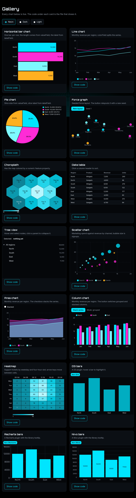 | 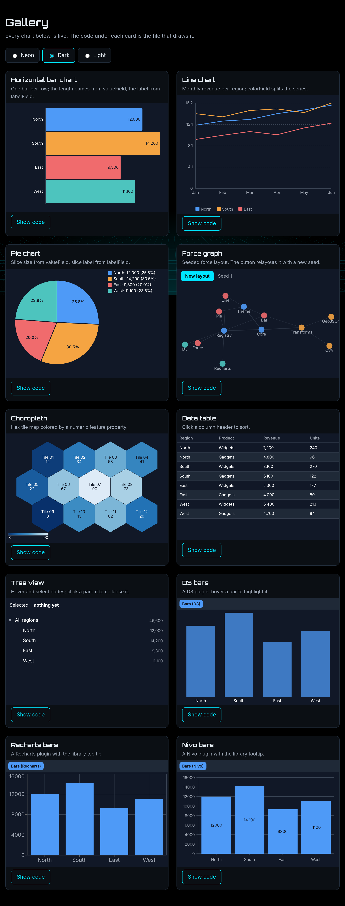 | 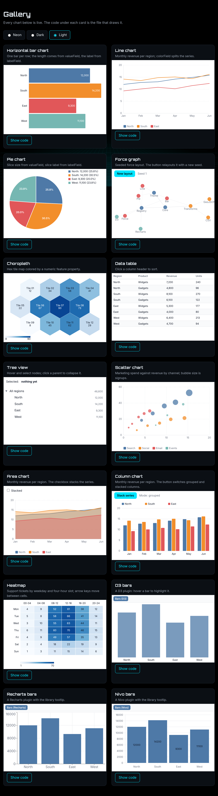 |

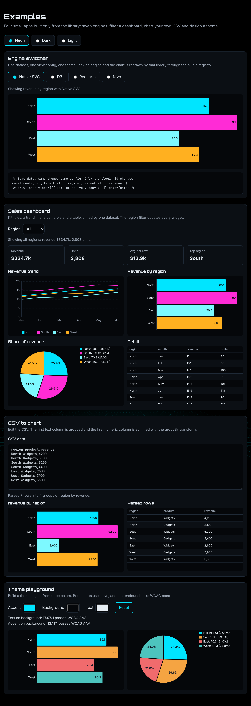

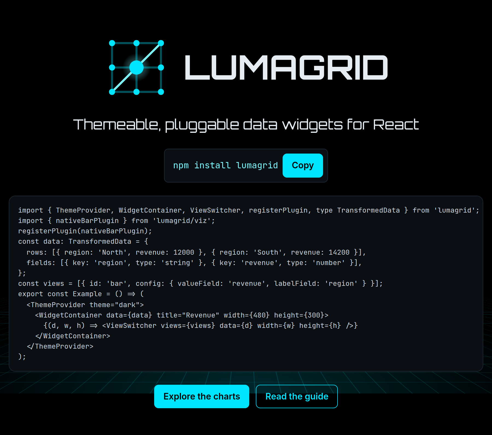

## How it fits together

Data flows through the transform layer, a plugin turns it into a renderer's shape, and the theme layer styles the result. Each layer imports only from the layers below it.

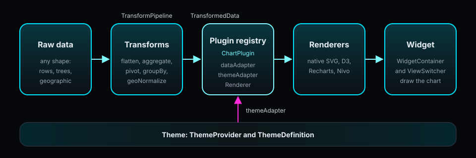

## Learn more

| | |
|---|---|
| Showcase site | https://bsommers.github.io/lumagrid/ |
| User guide | [docs/guide/README.md](docs/guide/README.md) |
| Bring your own engine | [docs/guide/bring-your-own-engine.md](docs/guide/bring-your-own-engine.md) |
| Live examples | https://bsommers.github.io/lumagrid/#examples |
| API reference | https://bsommers.github.io/lumagrid/api/ |
| Architecture | [docs/ARCHITECTURE.md](docs/ARCHITECTURE.md) |
| Using and configuring | [docs/USING.md](docs/USING.md) |
| Purpose | [docs/PURPOSE.md](docs/PURPOSE.md) |
| Stability | [docs/STABILITY.md](docs/STABILITY.md) |
| Changelog | [CHANGELOG.md](CHANGELOG.md) |
| Contributing | [CONTRIBUTING.md](CONTRIBUTING.md) |

Source: https://github.com/bsommers/lumagrid

## Stability

The public API is being frozen for 1.0. The tag policy and the stable and experimental lists are in [docs/STABILITY.md](docs/STABILITY.md).

## License

Apache License 2.0. See [LICENSE](LICENSE) and [NOTICE](NOTICE).
