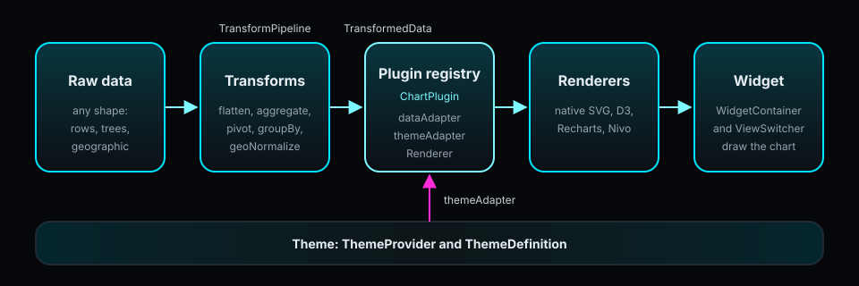
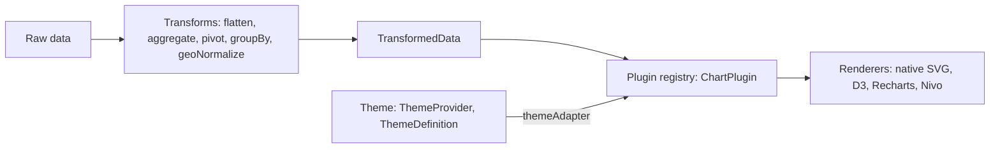
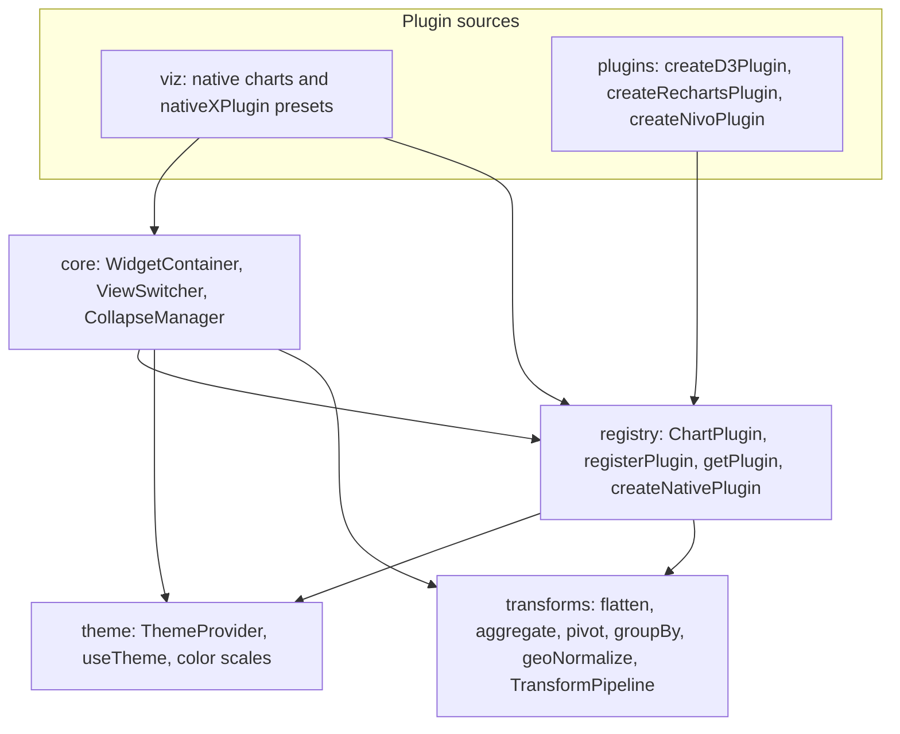
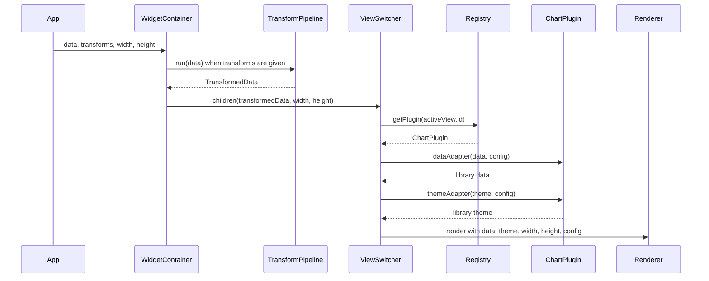
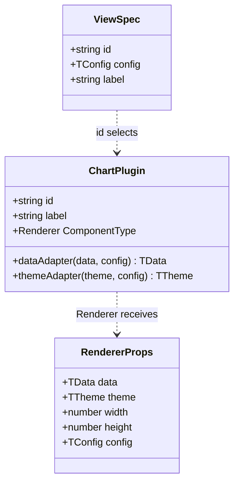
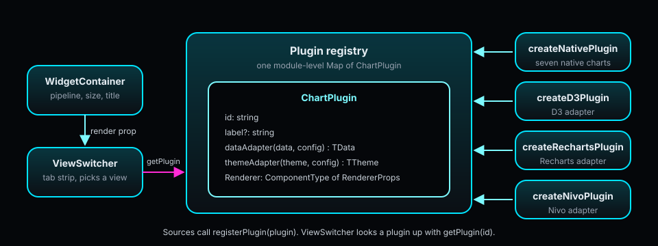

[← README](../README.md)

# Architecture

How Lumagrid is put together: the layers, the render data flow, the plugin contract, the package entry points and the gates that guard the public API.

## Contents

- [Overview](#overview)
- [Pipeline](#pipeline)
- [Layers](#layers)
- [Render data flow](#render-data-flow)
- [Plugin contract](#plugin-contract)
- [Entry points and build outputs](#entry-points-and-build-outputs)
- [Quality gates](#quality-gates)
- [Where to go next](#where-to-go-next)

## Overview

Lumagrid is a layered React and TypeScript library for data widgets. Raw data of any shape goes through a chain of transforms and comes out as one uniform `TransformedData` value (`rows`, `fields`, and optional `hierarchy`, `geo` and `meta`). A plugin registry maps a view id to a `ChartPlugin`, whose adapters turn that data and the current theme into whatever a chart renderer expects. `WidgetContainer` and `ViewSwitcher` wire the pieces together at render time.

The library draws its own SVG charts and also wraps D3, Recharts and Nivo through adapter factories. The adapter factories do not import those chart libraries: you import them in the `Renderer` you pass in, so the chart libraries stay your dependency.

## Pipeline

The same pipeline as a Mermaid diagram, for places where SVG images are blocked:

## Layers

Each layer imports only from layers below it. The transform layer has no React dependency and imports nothing from the other layers.

| Directory | Role | Imports from |
|-----------|------|--------------|
| `src/transforms` | Data transforms and `TransformPipeline`. Pure functions, no React. | nothing else in `src` |
| `src/theme` | `ThemeDefinition` tokens, `lightTheme`, `darkTheme`, `ThemeProvider`, `useTheme` and the color scales. | nothing else in `src` |
| `src/registry` | The `ChartPlugin` contract, the registry (`registerPlugin`, `getPlugin`, `listPlugins`) and `createNativePlugin`. | `theme`, `transforms` (types only) |
| `src/core` | `WidgetContainer`, `ViewSwitcher`, `CollapseManager`, `useCollapse`. | `registry`, `theme`, `transforms` |
| `src/viz` | The seven native SVG charts and their `native*Plugin` presets. | `registry`, `core`, `theme`, `transforms` |
| `src/plugins` | `createD3Plugin`, `createRechartsPlugin`, `createNivoPlugin`. | `registry`, `theme`, `transforms` (types only) |

The rule is checked against the real `import` statements in `src`: `src/transforms` and `src/theme` contain no import from a sibling layer, and `src/transforms` does not import React.

## Render data flow

What happens when an app renders a widget:

- `WidgetContainer` builds a `TransformPipeline` from its `transforms` prop and runs it over `data`. Without `transforms`, `data` is passed through and must already be a `TransformedData`.
- When `width` or `height` is a CSS string, `WidgetContainer` measures itself with a `ResizeObserver` and passes pixel sizes to its render prop.
- `ViewSwitcher` looks up the plugin for the active view with `getPlugin`, runs both adapters on every render, and renders the plugin's `Renderer`. If no plugin is registered under the id, it renders a short message telling you to call `registerPlugin`.
- The theme comes from the nearest `ThemeProvider` through `useTheme`.

## Plugin contract

A `ChartPlugin` is the only thing a chart integration has to provide. The renderer field is named `Renderer`.

- `dataAdapter` converts `TransformedData` into the shape the chart library wants. `themeAdapter` converts a `ThemeDefinition` into that library's styling tokens. Both may receive the per-view `config`.
- `ViewSpec` is what you pass to `ViewSwitcher`'s `views` prop: a registered plugin `id`, an optional `config` and an optional tab `label`. `label` on `ChartPlugin` defaults to the id.
- `registerPlugin(plugin)` stores the plugin under its `id` and returns the id. Registering an id again replaces the earlier plugin (see [Registry semantics](STABILITY.md#registry-semantics)).
- `createNativePlugin(id, Component, label)` wraps a native chart with identity adapters. The seven presets in `lumagrid/viz` (`nativeTablePlugin`, `nativeBarPlugin`, `nativeLinePlugin`, `nativePiePlugin`, `nativeChoroplethPlugin`, `nativeForceGraphPlugin`, `nativeTreePlugin`) are built with it.
- `createD3Plugin`, `createRechartsPlugin` and `createNivoPlugin` build a `ChartPlugin` around your own `Renderer`.

## Entry points and build outputs

`package.json` exposes five entry points. Each has an ESM build, a CJS build and type declarations.

| Entry point | `import` | `require` | `types` |
|-------------|----------|-----------|---------|
| `lumagrid` | `./dist/esm/index.js` | `./dist/cjs/index.cjs` | `./dist/esm/index.d.ts` |
| `lumagrid/transforms` | `./dist/esm/transforms/index.js` | `./dist/cjs/transforms/index.cjs` | `./dist/esm/transforms/index.d.ts` |
| `lumagrid/theme` | `./dist/esm/theme/index.js` | `./dist/cjs/theme/index.cjs` | `./dist/esm/theme/index.d.ts` |
| `lumagrid/viz` | `./dist/esm/viz/index.js` | `./dist/cjs/viz/index.cjs` | `./dist/esm/viz/index.d.ts` |
| `lumagrid/plugins` | `./dist/esm/plugins/index.js` | `./dist/cjs/plugins/index.cjs` | `./dist/esm/plugins/index.d.ts` |

- `npm run build` compiles ESM (`tsconfig.esm.json`) and then CJS (`tsconfig.cjs.json`) into `dist/`.
- The `files` field limits the published package to `dist`.
- The root `lumagrid` entry re-exports the theme, transform, registry, core, viz and plugin APIs. The `native*Plugin` presets are only on `lumagrid/viz`.

## Quality gates

- **Local CI.** `scripts/ci.sh` runs typecheck, lint, tests under a coverage gate (thresholds in `vitest.config.ts`), the library build, the API report check and the examples build. `scripts/ci.sh --fast` runs typecheck, lint and tests only. The pre-push hook in `.githooks/` runs it; see [CONTRIBUTING.md](../CONTRIBUTING.md#local-ci-primary-gate).
- **API reports.** api-extractor writes one report per entry point into `etc/` (`lumagrid.api.md`, `lumagrid-transforms.api.md`, `lumagrid-theme.api.md`, `lumagrid-viz.api.md`, `lumagrid-plugins.api.md`). `npm run api:check` fails when a report is stale or an export has no release tag; `npm run api:update` rewrites them after an intentional change.
- **Stability tags.** Every export carries `@public` or `@experimental` (paired with `@beta`). What each tag promises is in [STABILITY.md](STABILITY.md).
- **Registry test convention.** The registry is one shared module-level `Map`, so tests that call `registerPlugin` reset it in `beforeEach` with `__resetRegistryForTests`. See [CONTRIBUTING.md](../CONTRIBUTING.md#testing-conventions).

## Where to go next

- [Usage and configuration](USING.md) for install, entry points, scripts and environment variables.
- [Purpose](PURPOSE.md) for the problem the library solves and what it deliberately does not do.
- [User guide](guide/README.md), [getting started](guide/getting-started.md) and [troubleshooting](guide/troubleshooting.md).
