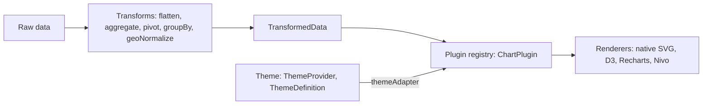

[← README](../README.md)

# Architecture

How Lumagrid is put together: the data pipeline from raw input to a drawn chart.

## Contents

- [Overview](#overview)
- [Pipeline](#pipeline)

## Overview

Lumagrid is a layered React and TypeScript library for data widgets. Raw data of any shape goes through a chain of transforms and comes out as one uniform `TransformedData` value. A plugin registry maps a view id to a `ChartPlugin`, whose adapters turn that data and the current theme into whatever a chart renderer expects. `WidgetContainer` and `ViewSwitcher` wire the pieces together at render time.

## Pipeline

The same pipeline as a Mermaid diagram, for places where SVG images are blocked:

