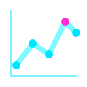
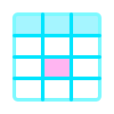
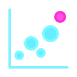
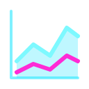
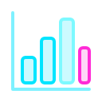
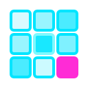

[← Guide](../README.md) | [← Project README](../../../README.md)

# Charts

One reference page per native chart: the data it needs, its props, a verified example and the rendered images in the light and dark themes. Every example lives in a type-checked file under `docs/guide/snippets/` and is copied into the page unchanged.

## Contents

- [The eleven charts](#the-eleven-charts)
- [Role field names](#role-field-names)
- [Images](#images)

## The eleven charts

| | Chart | Component | Plugin id | Data it needs | Stability |
|---|-------|-----------|-----------|---------------|-----------|
|  | [Bar chart](./bar-chart.md) | `HorizontalBarChart` | `bar` | a label column and a number column | stable |
|  | [Line chart](./line-chart.md) | `LineChart` | `line` | an x category, a number column, optional series column | stable |
|  | [Pie chart](./pie-chart.md) | `PieChart` | `pie` | a label column and a number column | stable |
|  | [Force graph](./force-graph.md) | `ForceGraph` | `force-graph` | node rows and edge rows in one dataset | stable, layout options experimental |
|  | [Choropleth](./choropleth.md) | `Choropleth` | `choropleth` | `geo` plus your own `projectedPaths` | stable, `projectedPaths` experimental |
|  | [Data table](./data-table.md) | `DataTable` | `table` | any rows | stable |
|  | [Tree view](./tree-view.md) | `TreeView` | `tree` | `hierarchy`, for example from `groupBy` | stable |
|  | [Scatter chart](./scatter-chart.md) | `ScatterChart` | `scatter` | two number columns, optional series and size columns | stable |
|  | [Area chart](./area-chart.md) | `AreaChart` | `area` | an x category, a number column, optional series column | stable |
|  | [Column chart](./column-chart.md) | `ColumnChart` | `column` | a category column, a number column, optional series column | stable |
|  | [Heatmap](./heatmap.md) | `Heatmap` | `heatmap` | a row column, a column column and a number column | stable |

## Role field names

Charts name their columns by role, and the same role means the same thing everywhere:

| Prop | Meaning | Used by |
|------|---------|---------|
| `valueField` | numeric measure | bar, line, pie, scatter, area, column, heatmap, choropleth |
| `labelField` | category or display label | bar, line, pie, area, column, heatmap, force graph |
| `idField` | node identifier | force graph |
| `colorField` | splits rows into series | line, scatter, area, column |

Resolution rules, and the deprecated aliases that map onto these names, are in [STABILITY](../../STABILITY.md#field-props).

## Images

The pictures are generated and committed in [docs/assets/charts](../../assets/charts/README.md). The nine SVG charts have light and dark PNG and SVG files. The data table and the tree view are HTML, so they have PNG files only.
