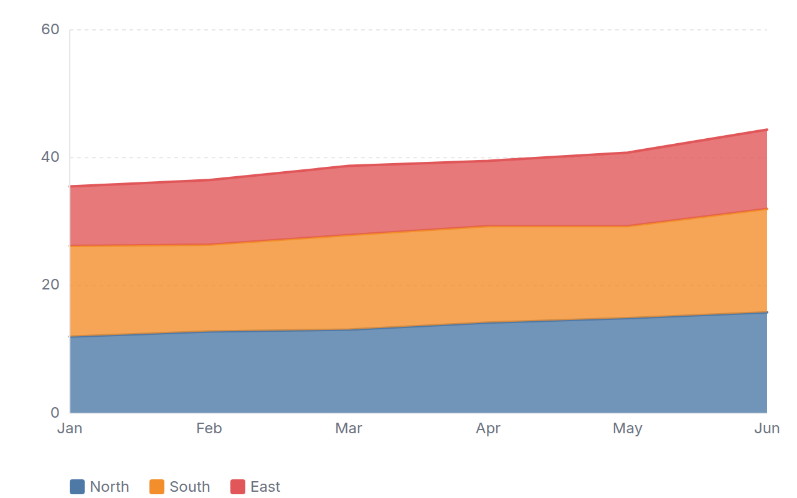
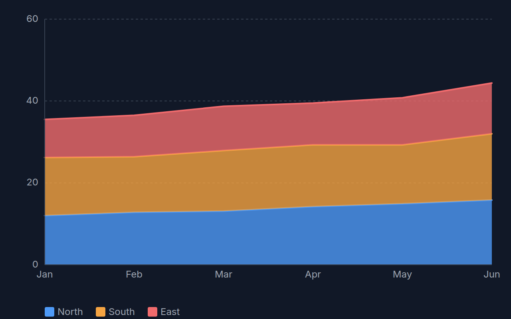

[← Guide](../README.md) | [← Project README](../../../README.md)

# Area chart

Filled areas across an ordered set of x categories, overlaid or stacked.

## Contents

- [Overview](#overview)
- [Data shape](#data-shape)
- [Props](#props)
- [Example](#example)
- [Rendered output](#rendered-output)
- [Accessibility](#accessibility)
- [See also](#see-also)

## Overview

| | |
|---|---|
| Component | `AreaChart` (from `lumagrid` or `lumagrid/viz`) |
| Plugin id | `area` (`nativeAreaPlugin`) |
| Stability | stable (see [STABILITY](../../STABILITY.md)) |

## Data shape

Long-form `rows` plus `fields`, the same shape as the [line chart](./line-chart.md): a label column for the x category, a number column for the value, and optionally a column that names the series. Categories are evenly spaced and are placed in the order they first appear. The y axis always includes 0. Rows with a missing value count as 0 and non-finite values are ignored. With `stacked`, each series is added on top of the previous ones.

## Props

| Prop | Meaning | When omitted |
|------|---------|--------------|
| `labelField` | column for the x category | the first `string` or `date` column in `data.fields` |
| `valueField` | column for the y value | the first `number` column in `data.fields` |
| `colorField` | column whose distinct values become separate colored areas | one area for all rows |
| `stacked` | stack the series instead of overlaying them | `false` |
| `showLegend` | render a color legend when `colorField` yields series | `true` |
| `ariaLabel` | accessible name of the chart | `Area chart of <value column>` |

The legacy `xField` and `yField` props are deprecated aliases of `labelField` and `valueField`; a role name wins over its alias.

At most five x tick labels are shown, each cut at 8 characters.

## Example

<!-- snippet: chart-area#area -->

```tsx
import { lightTheme } from 'lumagrid';
import type { TransformedData } from 'lumagrid';
import { AreaChart } from 'lumagrid/viz';

// Long form: one row per month and region.
const trend: TransformedData = {
  rows: [
    { month: 'Jan', revenue: 12.0, region: 'North' },
    { month: 'Feb', revenue: 12.8, region: 'North' },
    { month: 'Mar', revenue: 13.1, region: 'North' },
    { month: 'Jan', revenue: 14.2, region: 'South' },
    { month: 'Feb', revenue: 13.6, region: 'South' },
    { month: 'Mar', revenue: 14.8, region: 'South' },
  ],
  fields: [
    { key: 'month', type: 'string' },
    { key: 'revenue', type: 'number' },
    { key: 'region', type: 'string' },
  ],
};

// stacked adds the series on top of each other; labelField is the x category, colorField splits the series.
export function Example() {
  return (
    <AreaChart
      data={trend}
      width={600}
      height={300}
      theme={lightTheme}
      labelField="month"
      valueField="revenue"
      colorField="region"
      stacked
      ariaLabel="Monthly revenue by region"
    />
  );
}
```

As a switchable view:

<!-- snippet: chart-area#area-view -->

```tsx
// The same chart as a ViewSwitcher view: register nativeAreaPlugin, then name it by id.
export const areaView = {
  id: 'area',
  label: 'Area chart',
  config: { labelField: 'month', valueField: 'revenue', colorField: 'region', stacked: true },
};
```

## Rendered output

Light theme:



Dark theme:



Vector versions: [light SVG](../../assets/charts/area-light.svg) and [dark SVG](../../assets/charts/area-dark.svg). The images are generated; see [Chart images](../../assets/charts/README.md).

## Accessibility

The chart is one `<svg>` with `role="img"` and an `aria-label`. The legend names every series, and a visually hidden data table lists every value, so each series and data point has a text alternative. Overlaid areas are semi-transparent; use `stacked` when series overlap heavily.

## See also

- [Theming](../theming.md): the `theme` prop and the color scale.
- [Plugins and adapters](../plugins-and-adapters.md): registering `area` and the conformance kit that checks it.
- [Troubleshooting](../troubleshooting.md): a chart that stays empty.
- [All charts](./README.md)
