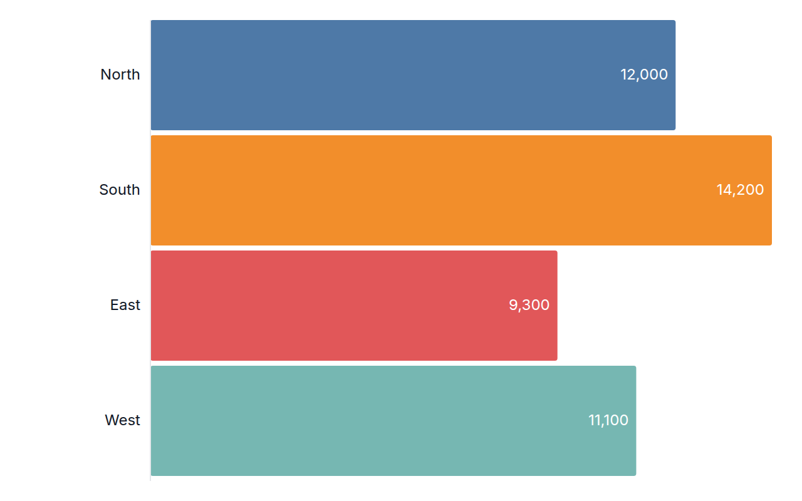
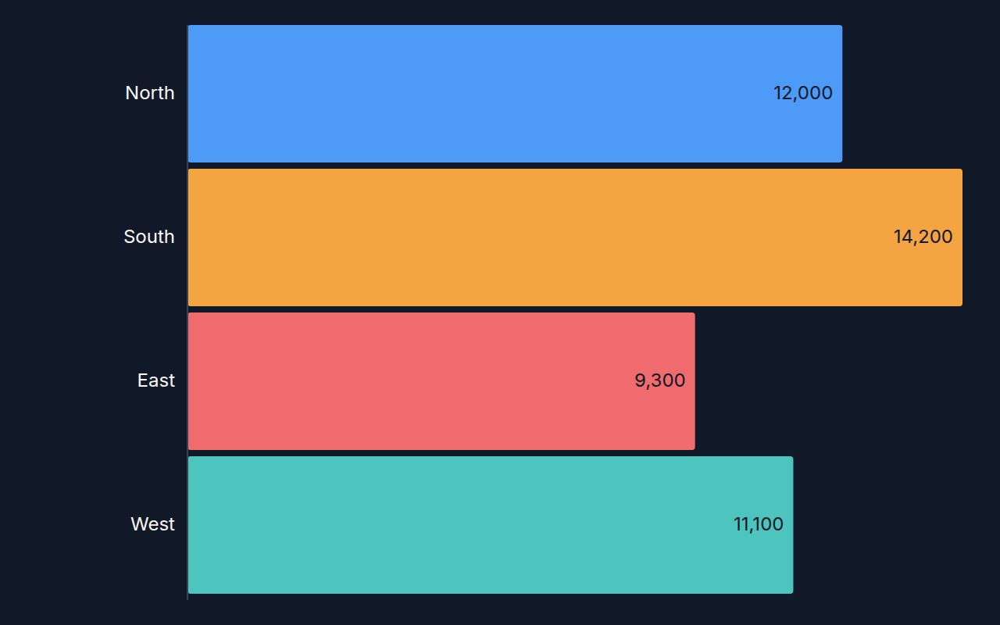

[← Guide](../README.md) | [← Project README](../../../README.md)

# Bar chart

A horizontal bar chart: one bar per row, with the value setting the bar length and the label drawn to its left.

## Contents

- [Overview](#overview)
- [Data shape](#data-shape)
- [Props](#props)
- [Example](#example)
- [Rendered output](#rendered-output)
- [Accessibility](#accessibility)
- [See also](#see-also)

## Overview

| | |
|---|---|
| Component | `HorizontalBarChart` (from `lumagrid` or `lumagrid/viz`) |
| Plugin id | `bar` (`nativeBarPlugin`) |
| Stability | stable (see [STABILITY](../../STABILITY.md)) |

## Data shape

Plain `rows` plus `fields`: one string column for the label and one number column for the value. No other transform is needed. Rows whose value is not a finite number are skipped, and a missing value counts as 0.

## Props

All props come from `NativeChartProps`. The chart needs `data`, `width`, `height` and `theme`; the rest are optional.

| Prop | Meaning | When omitted |
|------|---------|--------------|
| `valueField` | column that sets the bar length | the first `number` column in `data.fields` |
| `labelField` | column drawn as the bar label | the first `string` column in `data.fields` |
| `ariaLabel` | accessible name of the chart | `Horizontal bar chart of <value column>` |

The legacy `xField` and `yField` props are deprecated aliases of `valueField` and `labelField`; they still work, a role name wins over its alias, and both are removed in 2.0.

Long labels are cut at 14 characters, and a bar shows its value inside only when it is wider than 40 pixels. Every bar has a tooltip title with the label and the full value. The chart is at least `height` tall and grows when there are many rows.

## Example

Draw the component directly, passing the theme as a prop:

<!-- snippet: chart-bar#bar -->

```tsx
import { lightTheme } from 'lumagrid';
import type { TransformedData } from 'lumagrid';
import { HorizontalBarChart } from 'lumagrid/viz';

const sales: TransformedData = {
  rows: [
    { region: 'North', revenue: 12000 },
    { region: 'South', revenue: 14200 },
    { region: 'East', revenue: 9300 },
    { region: 'West', revenue: 11100 },
  ],
  fields: [
    { key: 'region', type: 'string' },
    { key: 'revenue', type: 'number' },
  ],
};

// valueField is the bar length, labelField is the text beside each bar.
export function Example() {
  return (
    <HorizontalBarChart
      data={sales}
      width={600}
      height={240}
      theme={lightTheme}
      valueField="revenue"
      labelField="region"
      ariaLabel="Revenue by region"
    />
  );
}
```

To use the chart as a switchable view instead, give `ViewSwitcher` this view config (see [Getting started](../getting-started.md)):

<!-- snippet: chart-bar#bar-view -->

```tsx
// The same chart as a ViewSwitcher view: register nativeBarPlugin, then name it by id.
export const barView = {
  id: 'bar',
  label: 'Bar chart',
  config: { valueField: 'revenue', labelField: 'region' },
};
```

## Rendered output

Light theme:



Dark theme:



Vector versions: [light SVG](../../assets/charts/bar-light.svg) and [dark SVG](../../assets/charts/bar-dark.svg). The images are generated; see [Chart images](../../assets/charts/README.md).

## Accessibility

The chart is one `<svg>` with `role="img"` and an `aria-label` (your `ariaLabel`, or the default above). Each bar carries a `<title>` with its label and value, which screen readers and browser tooltips can announce. The text colors come from the theme tokens, so contrast follows the theme you pass.

## See also

- [Theming](../theming.md): the `theme` prop and the color scale.
- [Plugins and adapters](../plugins-and-adapters.md): registering `bar` and drawing the same data with D3, Recharts or Nivo.
- [Troubleshooting](../troubleshooting.md): a chart that stays empty.
- [All charts](./README.md)
