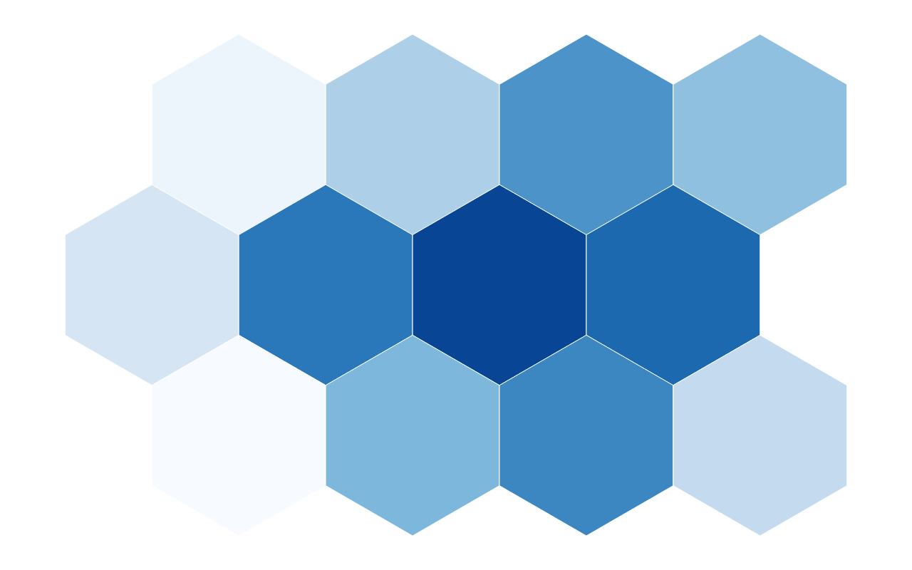
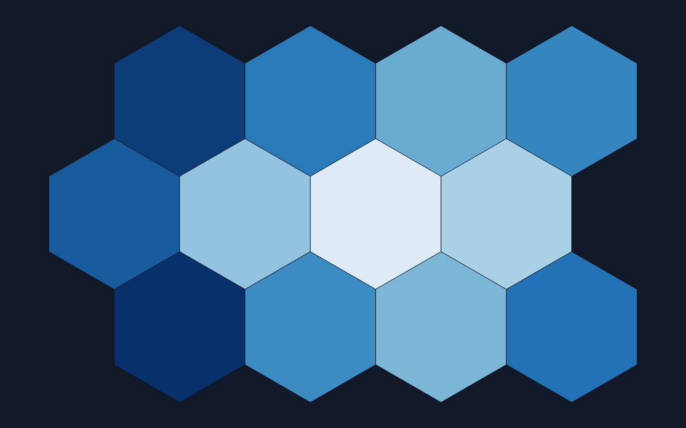

[← Guide](../README.md) | [← Project README](../../../README.md)

# Choropleth

A map whose regions are colored by a numeric property.

## Contents

- [Overview](#overview)
- [Data shape](#data-shape)
- [Props](#props)
- [Example](#example)
- [Rendered output](#rendered-output)
- [Accessibility](#accessibility)
- [See also](#see-also)

## Overview

| | |
|---|---|
| Component | `Choropleth` (from `lumagrid` or `lumagrid/viz`); its props type `ChoroplethProps` is exported too |
| Plugin id | `choropleth` (`nativeChoroplethPlugin`) |
| Stability | stable; the `projectedPaths` prop is **experimental** and may change in a minor release (see [STABILITY](../../STABILITY.md#experimental-experimental-also-beta)) |

## Data shape

The map lives in `data.geo`, a GeoJSON `FeatureCollection`. Each feature has a string `id` and primitive `properties`, and the property you color by must be a number. Use the `geoNormalize` transform to attach GeoJSON to your data (see [Transforms](../transforms.md)), or build the object by hand as in the example. Features whose property is missing or not a number are drawn in the theme's border color.

## Props

| Prop | Meaning | When omitted |
|------|---------|--------------|
| `valueProperty` | feature property that sets the color; wins over `valueField` | falls through to `valueField` |
| `valueField` | the same, under the shared role name | the literal `value` property |
| `projectedPaths` (experimental) | object mapping each feature `id` to an SVG path string | a placeholder is drawn instead of a map |
| `ariaLabel` | accessible name of the map | `Choropleth map` |

The legacy `yField` prop is a deprecated alias of `valueField`; it still works, `valueField` wins over it, and it is removed in 2.0.

**The library has no projection engine.** It does not turn GeoJSON coordinates into pixels. You supply `projectedPaths`, typically generated with `geoPath` from d3-geo, one path string per feature `id`, sized to the `width` and `height` you pass. A feature with no entry in `projectedPaths` is not drawn.

Without `projectedPaths` the chart does not draw a map. It shows a placeholder panel with the feature count, the value field in use, the text "Pass projectedPaths (from a D3 geoPath projection) to render the map, or use the D3 adapter to attach a full projection-based renderer", and the sequential color ramp. If `data.geo` is missing altogether, the text reads "Choropleth requires a GeoData object. Use the geoNormalize transform to attach GeoJSON."

Colors come from the theme's sequential scale, from the lowest to the highest value in the data.

## Example

<!-- snippet: chart-choropleth#choropleth -->

```tsx
import { lightTheme } from 'lumagrid';
import type { TransformedData } from 'lumagrid';
import { Choropleth } from 'lumagrid/viz';

// Features need a string id and primitive properties. The geometry is not drawn by
// the library, so it can stay as GeoJSON for your own projection code.
export const tiles: TransformedData = {
  rows: [],
  fields: [],
  geo: {
    type: 'FeatureCollection',
    features: [
      { type: 'Feature', id: 'a', properties: { name: 'Tile A', value: 12 }, geometry: { type: 'Polygon', coordinates: [] } },
      { type: 'Feature', id: 'b', properties: { name: 'Tile B', value: 58 }, geometry: { type: 'Polygon', coordinates: [] } },
      { type: 'Feature', id: 'c', properties: { name: 'Tile C', value: 90 }, geometry: { type: 'Polygon', coordinates: [] } },
    ],
  },
};

// The library has no projection engine. Supply one SVG path string per feature id
// (for example from d3-geo's geoPath); without projectedPaths a placeholder is drawn.
export const projectedPaths: Record<string, string> = {
  a: 'M10,10 L190,10 L190,130 L10,130 Z',
  b: 'M200,10 L380,10 L380,130 L200,130 Z',
  c: 'M10,140 L380,140 L380,230 L10,230 Z',
};

export function Example() {
  return (
    <Choropleth
      data={tiles}
      width={400}
      height={240}
      theme={lightTheme}
      valueProperty="value"
      projectedPaths={projectedPaths}
      ariaLabel="Value by tile"
    />
  );
}
```

As a switchable view:

<!-- snippet: chart-choropleth#choropleth-view -->

```tsx
// The same chart as a ViewSwitcher view: register nativeChoroplethPlugin, then name it by id.
export const choroplethView = {
  id: 'choropleth',
  label: 'Map',
  config: { valueProperty: 'value', projectedPaths },
};
```

## Rendered output

Light theme:



Dark theme:



Vector versions: [light SVG](../../assets/charts/choropleth-light.svg) and [dark SVG](../../assets/charts/choropleth-dark.svg). The images are generated; see [Chart images](../../assets/charts/README.md).

The pictures show a tile map of twelve hexagons whose paths were generated for the capture; they are not a geographic projection.

## Accessibility

With `projectedPaths` the chart is one `<svg>` with `role="img"` and an `aria-label` (your `ariaLabel`, or the default above), and each region has a `<title>` with its name and value (a dash when there is none). The placeholder is plain text in a `div`. Color alone carries the value, so give the numbers in nearby text or in the [data table](./data-table.md).

## See also

- [Theming](../theming.md): the `theme` prop and the color scale.
- [Plugins and adapters](../plugins-and-adapters.md): registering `choropleth` and drawing the same data with D3, Recharts or Nivo.
- [Troubleshooting](../troubleshooting.md): a chart that stays empty.
- [All charts](./README.md)
