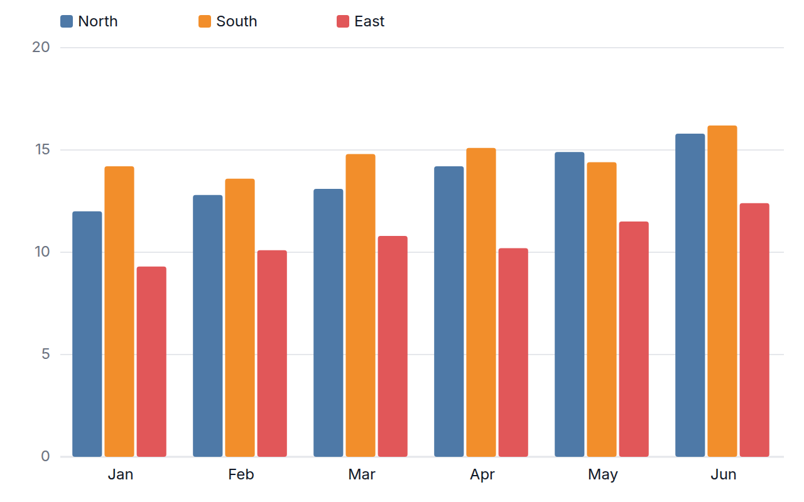
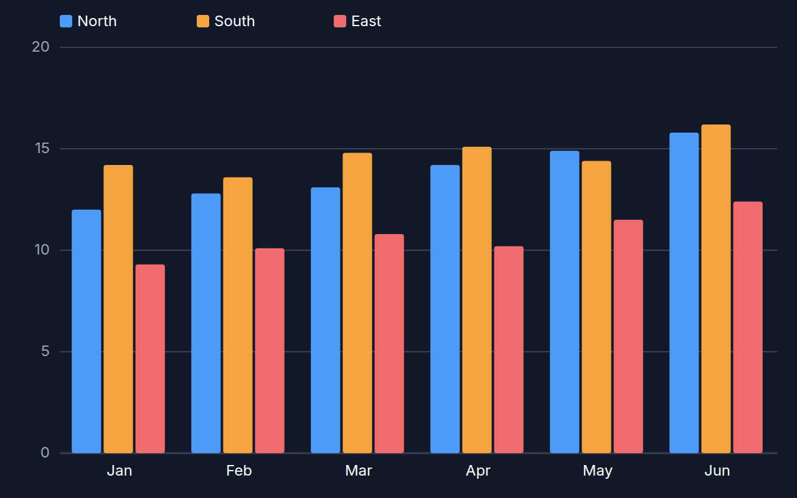

[← Guide](../README.md) | [← Project README](../../../README.md)

# Column chart

Vertical bars by category, grouped side by side or stacked per series.

## Contents

- [Overview](#overview)
- [Data shape](#data-shape)
- [Props](#props)
- [Example](#example)
- [Rendered output](#rendered-output)
- [Accessibility](#accessibility)
- [See also](#see-also)

## Overview

| | |
|---|---|
| Component | `ColumnChart` (from `lumagrid` or `lumagrid/viz`) |
| Plugin id | `column` (`nativeColumnPlugin`) |
| Stability | stable (see [STABILITY](../../STABILITY.md)) |

## Data shape

Long-form `rows` plus `fields`: a string column for the category on the x axis, a number column for the height, and optionally a string column that names the series. Rows with the same category and series are added together. Negative values are drawn below the zero line, and the y axis always includes 0.

## Props

| Prop | Meaning | When omitted |
|------|---------|--------------|
| `labelField` | column for the x category | the first `string` column in `data.fields` |
| `valueField` | column for the bar value | the first `number` column in `data.fields` |
| `colorField` | column whose distinct values become separate series | one series for all rows |
| `mode` | `'grouped'` draws the series side by side, `'stacked'` stacks them | `'grouped'` |
| `showLegend` | render a series legend | `true` |
| `showValues` | print the value on each bar when it fits | `false` |
| `ariaLabel` | accessible name of the chart | `Column chart of <value column>` |

The legacy `xField` and `yField` props are aliases of `labelField` and `valueField`. Category and series labels longer than 12 characters are cut with an ellipsis.

## Example

<!-- snippet: chart-column#column -->

```tsx
import { lightTheme } from 'lumagrid';
import type { TransformedData } from 'lumagrid';
import { ColumnChart } from 'lumagrid/viz';

// Long form: one row per month and region.
const trend: TransformedData = {
  rows: [
    { month: 'Jan', revenue: 12.0, region: 'North' },
    { month: 'Feb', revenue: 12.8, region: 'North' },
    { month: 'Mar', revenue: 13.1, region: 'North' },
    { month: 'Jan', revenue: 14.2, region: 'South' },
    { month: 'Feb', revenue: 13.6, region: 'South' },
    { month: 'Mar', revenue: 14.8, region: 'South' },
  ],
  fields: [
    { key: 'month', type: 'string' },
    { key: 'revenue', type: 'number' },
    { key: 'region', type: 'string' },
  ],
};

// mode is 'grouped' (side by side, the default) or 'stacked'; colorField splits the series.
export function Example() {
  return (
    <ColumnChart
      data={trend}
      width={600}
      height={300}
      theme={lightTheme}
      labelField="month"
      valueField="revenue"
      colorField="region"
      mode="stacked"
      ariaLabel="Monthly revenue by region"
    />
  );
}
```

As a switchable view:

<!-- snippet: chart-column#column-view -->

```tsx
// The same chart as a ViewSwitcher view: register nativeColumnPlugin, then name it by id.
export const columnView = {
  id: 'column',
  label: 'Column chart',
  config: { labelField: 'month', valueField: 'revenue', colorField: 'region', mode: 'stacked' },
};
```

## Rendered output

Light theme:



Dark theme:



Vector versions: [light SVG](../../assets/charts/column-light.svg) and [dark SVG](../../assets/charts/column-dark.svg). The images are generated; see [Chart images](../../assets/charts/README.md).

## Accessibility

The chart is one `<svg>` with `role="img"` and an `aria-label`, and each bar carries its own `aria-label` of category, series and value. The legend names the series. Value labels, when shown, switch between light and dark text to keep contrast against the bar color.

## See also

- [Theming](../theming.md): the `theme` prop and the color scale.
- [Plugins and adapters](../plugins-and-adapters.md): registering `column` and the conformance kit that checks it.
- [Troubleshooting](../troubleshooting.md): a chart that stays empty.
- [All charts](./README.md)
