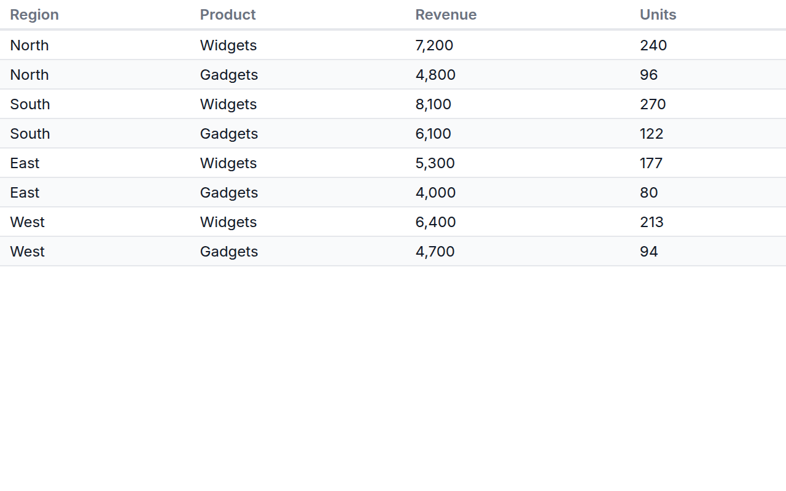
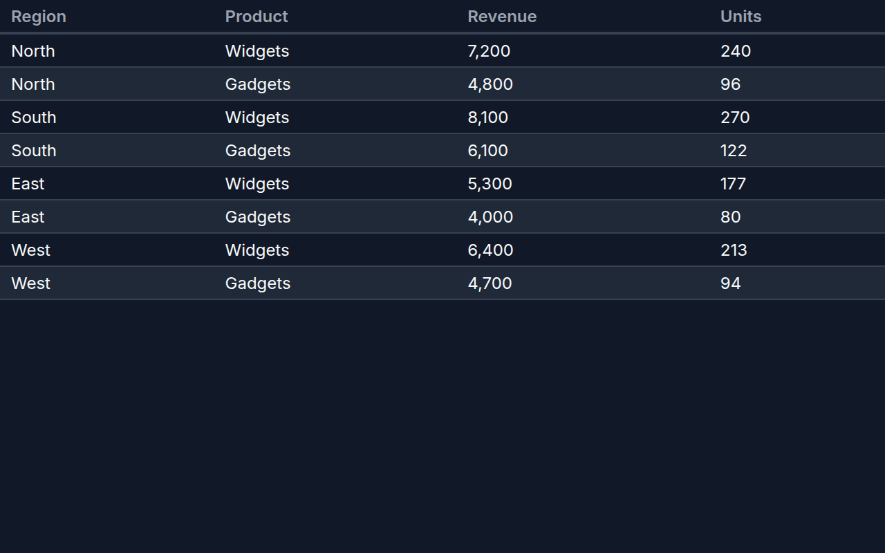

[← Guide](../README.md) | [← Project README](../../../README.md)

# Data table

A sortable, paged table of every row and field.

## Contents

- [Overview](#overview)
- [Data shape](#data-shape)
- [Props](#props)
- [Example](#example)
- [Rendered output](#rendered-output)
- [Accessibility](#accessibility)
- [See also](#see-also)

## Overview

| | |
|---|---|
| Component | `DataTable` (from `lumagrid` or `lumagrid/viz`) |
| Plugin id | `table` (`nativeTablePlugin`) |
| Stability | stable (see [STABILITY](../../STABILITY.md)) |

## Data shape

Any `rows`. Columns come from `data.fields`, in that order, using `label` as the header text when it is set and `key` otherwise. If `fields` is empty, the columns are the keys of the first row and all are treated as text. Missing values print as a dash, and number columns are formatted with the viewer's locale.

## Props

The table takes no role field props: it ignores `valueField`, `labelField`, `idField` and `colorField`. It needs only `data`, `height` and `theme`. The legacy `xField` and `yField` props are likewise ignored.

| Behavior | Detail |
|----------|--------|
| Sorting | click a header to sort ascending by that column; click it again to flip the direction. An arrow marks the sorted column. |
| Paging | 25 rows per page. A footer with previous and next buttons and "Page N of M" appears only when there is more than one page. |
| Height | the table scrolls inside `height`; the width is 100 percent of the container. |

## Example

<!-- snippet: chart-table#table -->

```tsx
import { lightTheme } from 'lumagrid';
import type { TransformedData } from 'lumagrid';
import { DataTable } from 'lumagrid/viz';

// Columns come from fields; label is the header text shown instead of the key.
const orders: TransformedData = {
  rows: [
    { region: 'North', product: 'Widgets', revenue: 7200, units: 240 },
    { region: 'North', product: 'Gadgets', revenue: 4800, units: 96 },
    { region: 'South', product: 'Widgets', revenue: 8100, units: 270 },
    { region: 'South', product: 'Gadgets', revenue: 6100, units: 122 },
  ],
  fields: [
    { key: 'region', type: 'string', label: 'Region' },
    { key: 'product', type: 'string', label: 'Product' },
    { key: 'revenue', type: 'number', label: 'Revenue' },
    { key: 'units', type: 'number', label: 'Units' },
  ],
};

// The table takes no role field props. Click a header to sort.
export function Example() {
  return <DataTable data={orders} width={600} height={240} theme={lightTheme} />;
}
```

As a switchable view:

<!-- snippet: chart-table#table-view -->

```tsx
// The same table as a ViewSwitcher view: register nativeTablePlugin, then name it by id.
export const tableView = { id: 'table', label: 'Table' };
```

## Rendered output

Light theme:



Dark theme:



Only PNG files exist for this chart. It renders HTML elements rather than an SVG drawing, and the capture deliberately does not wrap HTML in a `foreignObject` (unreliable outside browsers, and extra active content in a committed SVG), so no SVG is produced. The images are generated; see [Chart images](../../assets/charts/README.md).

## Accessibility

The chart is a native HTML `<table>` with a `<thead>` and `<th>` header cells, so assistive technology announces rows and columns. Header cells respond to mouse clicks to sort but are not focusable, so sorting is not available from the keyboard; the paging buttons are real buttons and are. Text and zebra rows use theme colors, so contrast follows the theme you pass.

## See also

- [Theming](../theming.md): the `theme` prop and the color scale.
- [Plugins and adapters](../plugins-and-adapters.md): registering `table` and drawing the same data with D3, Recharts or Nivo.
- [Troubleshooting](../troubleshooting.md): a chart that stays empty.
- [All charts](./README.md)
