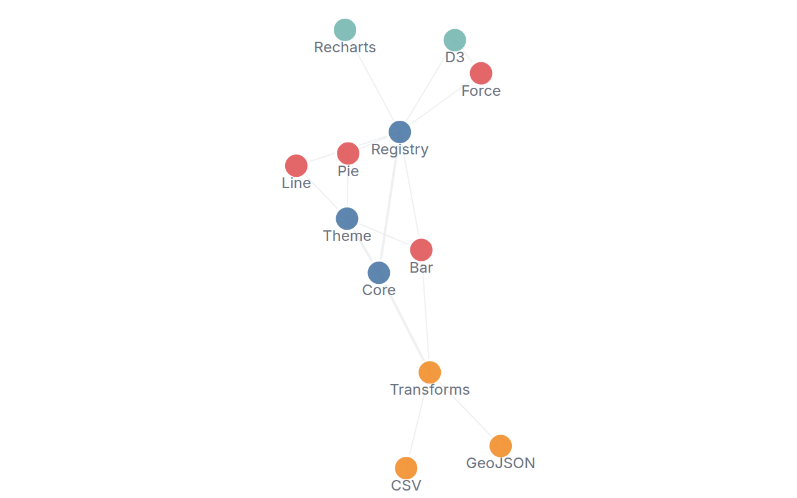
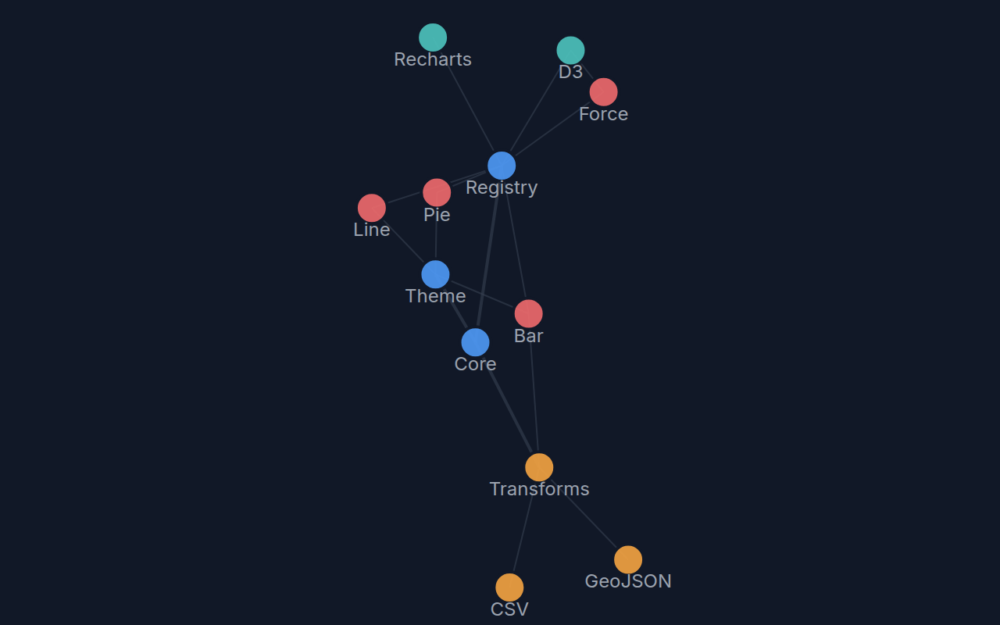

[← Guide](../README.md) | [← Project README](../../../README.md)

# Force graph

A force-directed node and edge diagram, laid out deterministically.

## Contents

- [Overview](#overview)
- [Data shape](#data-shape)
- [Props](#props)
- [Example](#example)
- [Rendered output](#rendered-output)
- [Accessibility](#accessibility)
- [See also](#see-also)

## Overview

| | |
|---|---|
| Component | `ForceGraph` (from `lumagrid` or `lumagrid/viz`); its props type `ForceGraphProps` is exported too |
| Plugin id | `force-graph` (`nativeForceGraphPlugin`) |
| Stability | stable; the `relayout`, `seed` and `iterations` options are **experimental** and may change in a minor release (see [STABILITY](../../STABILITY.md#experimental-experimental-also-beta)) |

## Data shape

One `rows` array holds both nodes and edges. A row with a `source` column that is not null is an edge, with `source` and `target` naming node ids and an optional numeric `weight`. Every other row is a node, with an id column, a label column and an optional `group` column; nodes in the same group share a color. An edge whose source or target is not a known node id is skipped.

The layout is a simple pairwise-repulsion simulation, quadratic in the number of nodes per iteration. It suits dashboard-sized graphs (tens to low hundreds of nodes), not thousands.

## Props

| Prop | Meaning | When omitted |
|------|---------|--------------|
| `idField` | column holding the node id | the literal `id` column |
| `labelField` | column holding the node label | the literal `label` column |
| `ariaLabel` | accessible name of the chart | `Force-directed graph` |
| `seed` (experimental) | seed for the initial node placement | `1` |
| `iterations` (experimental) | simulation iterations per layout run | `60` |
| `relayout` (experimental) | run the simulation again when the nodes or edges change | `true` |

The legacy `xField` and `yField` props are deprecated aliases of `idField` and `labelField`; they still work, a role name wins over its alias, and both are removed in 2.0.

Behavior of the experimental options, as covered by the component's tests:

- The same data, `seed` and `iterations` always give the same picture, so the committed images are reproducible. Change `seed` to get a different arrangement.
- The layout runs again only when the node ids, the edges, `seed` or `iterations` change. Changing a label or group updates the text and colors without moving anything.
- Resizing never runs the layout again; the existing positions are rescaled to fit.
- With `relayout={false}`, later data changes keep existing nodes where they are, place new nodes at their seeded start position, and drop removed nodes, without a new simulation.

Labels are cut at 12 characters and the weight sets the edge width.

## Example

<!-- snippet: chart-force#force -->

```tsx
import { lightTheme } from 'lumagrid';
import type { TransformedData } from 'lumagrid';
import { ForceGraph } from 'lumagrid/viz';

// Node rows carry id and label (and an optional group that sets the color).
// Rows with a source column are edges: source and target are node ids, weight is optional.
export const network: TransformedData = {
  rows: [
    { id: 'core', label: 'Core', group: 'platform' },
    { id: 'theme', label: 'Theme', group: 'platform' },
    { id: 'bar', label: 'Bar', group: 'viz' },
    { id: 'line', label: 'Line', group: 'viz' },
    { source: 'core', target: 'theme', weight: 2 },
    { source: 'core', target: 'bar' },
    { source: 'theme', target: 'bar' },
    { source: 'theme', target: 'line' },
  ],
  fields: [
    { key: 'id', type: 'string' },
    { key: 'label', type: 'string' },
    { key: 'group', type: 'string' },
    { key: 'source', type: 'string' },
    { key: 'target', type: 'string' },
    { key: 'weight', type: 'number' },
  ],
};

// idField and labelField name the node columns. seed and iterations are experimental.
export function Example() {
  return (
    <ForceGraph
      data={network}
      width={600}
      height={360}
      theme={lightTheme}
      idField="id"
      labelField="label"
      seed={1}
      iterations={60}
      ariaLabel="Module dependency graph"
    />
  );
}
```

As a switchable view:

<!-- snippet: chart-force#force-view -->

```tsx
// The same chart as a ViewSwitcher view: register nativeForceGraphPlugin, then name it by id.
export const forceView = {
  id: 'force-graph',
  label: 'Network',
  config: { idField: 'id', labelField: 'label', seed: 1 },
};
```

## Rendered output

Light theme:



Dark theme:



Vector versions: [light SVG](../../assets/charts/force-light.svg) and [dark SVG](../../assets/charts/force-dark.svg). The images are generated; see [Chart images](../../assets/charts/README.md).

## Accessibility

The chart is one `<svg>` with `role="img"` and an `aria-label` (your `ariaLabel`, or the default above). Each node has a `<title>` with its label, but edges have no text alternative, so describe the important relationships in nearby text. There is no keyboard interaction.

## See also

- [Theming](../theming.md): the `theme` prop and the color scale.
- [Plugins and adapters](../plugins-and-adapters.md): registering `force-graph` and drawing the same data with D3, Recharts or Nivo.
- [Troubleshooting](../troubleshooting.md): a chart that stays empty.
- [All charts](./README.md)
