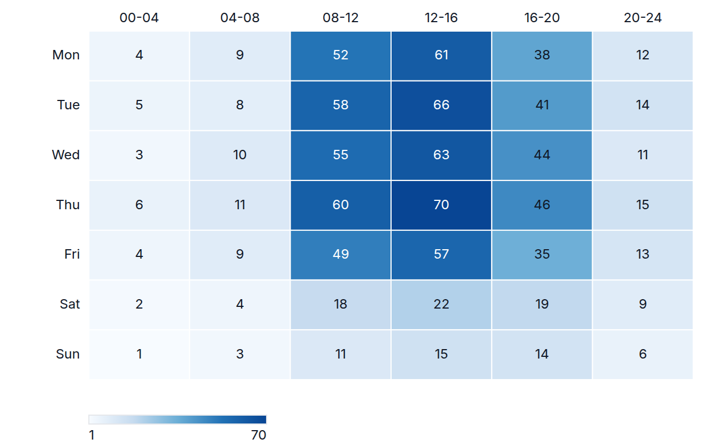
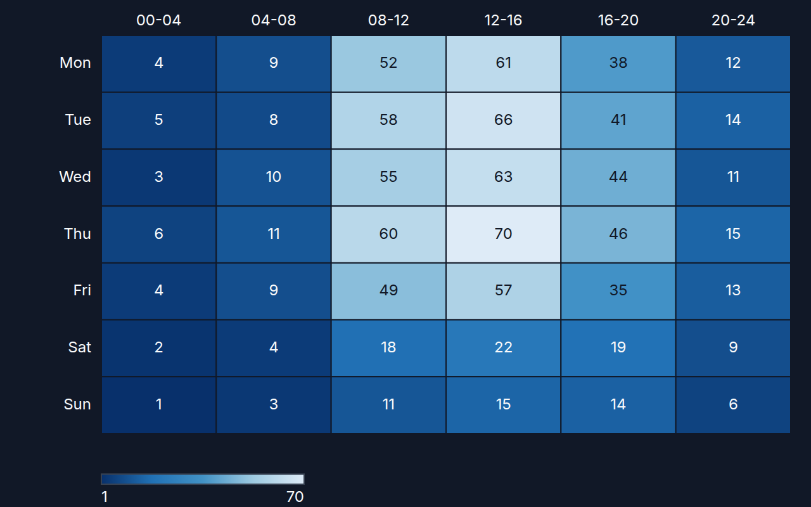

[← Guide](../README.md) | [← Project README](../../../README.md)

# Heatmap

A rows by columns matrix of cells colored on the theme's sequential scale.

## Contents

- [Overview](#overview)
- [Data shape](#data-shape)
- [Props](#props)
- [Example](#example)
- [Rendered output](#rendered-output)
- [Accessibility](#accessibility)
- [See also](#see-also)

## Overview

| | |
|---|---|
| Component | `Heatmap` (from `lumagrid` or `lumagrid/viz`) |
| Plugin id | `heatmap` (`nativeHeatmapPlugin`) |
| Stability | stable (see [STABILITY](../../STABILITY.md)) |

## Data shape

Long-form `rows` plus `fields`: two string columns that name the column and the row of each cell, and a number column for the value. Row and column labels appear in the order they first occur. If a row and column pair occurs twice, the last row wins. Rows with a missing or non-finite value are skipped.

## Props

| Prop | Meaning | When omitted |
|------|---------|--------------|
| `columnField` | column naming the column of each cell | `labelField`, then the first `string` column |
| `rowField` | column naming the row of each cell | the second `string` column |
| `valueField` | number column that sets the cell color | the first `number` column in `data.fields` |
| `showValues` | print the value inside each cell | `true` |
| `showLegend` | render a min to max color legend | `true` |
| `onSelect` | called with `{ row, column, value }` when a cell is clicked or activated with Enter or Space | no callback |
| `ariaLabel` | accessible name of the chart | `Heatmap of <value column>` |

The legacy `xField` and `yField` props are aliases of `columnField` and `rowField`. Labels are cut with an ellipsis when they do not fit.

## Example

<!-- snippet: chart-heatmap#heatmap -->

```tsx
import { lightTheme } from 'lumagrid';
import type { TransformedData } from 'lumagrid';
import { Heatmap } from 'lumagrid/viz';

// One row per cell: support tickets opened per weekday and slot of the day.
const tickets: TransformedData = {
  rows: [
    { day: 'Mon', slot: '08-12', tickets: 52 },
    { day: 'Mon', slot: '12-16', tickets: 61 },
    { day: 'Mon', slot: '16-20', tickets: 38 },
    { day: 'Tue', slot: '08-12', tickets: 58 },
    { day: 'Tue', slot: '12-16', tickets: 66 },
    { day: 'Tue', slot: '16-20', tickets: 41 },
  ],
  fields: [
    { key: 'day', type: 'string' },
    { key: 'slot', type: 'string' },
    { key: 'tickets', type: 'number' },
  ],
};

// columnField and rowField name the two axes; valueField is the number that colors each cell.
export function Example() {
  return (
    <Heatmap
      data={tickets}
      width={600}
      height={300}
      theme={lightTheme}
      valueField="tickets"
      columnField="slot"
      rowField="day"
      ariaLabel="Support tickets by weekday and time slot"
    />
  );
}
```

As a switchable view:

<!-- snippet: chart-heatmap#heatmap-view -->

```tsx
// The same chart as a ViewSwitcher view: register nativeHeatmapPlugin, then name it by id.
export const heatmapView = {
  id: 'heatmap',
  label: 'Heatmap',
  config: { valueField: 'tickets', columnField: 'slot', rowField: 'day' },
};
```

## Rendered output

Light theme:



Dark theme:



Vector versions: [light SVG](../../assets/charts/heatmap-light.svg) and [dark SVG](../../assets/charts/heatmap-dark.svg). The images are generated; see [Chart images](../../assets/charts/README.md).

## Accessibility

The chart is an `<svg>` with `role="grid"`, `aria-rowcount` and `aria-colcount`; every cell is a `gridcell` with an `aria-label` of row, column and value. One cell is in the tab order, and the arrow keys and Home and End move between cells. Cell values are drawn in the text color with the best contrast against the cell fill.

## See also

- [Theming](../theming.md): the `theme` prop and the color scale.
- [Plugins and adapters](../plugins-and-adapters.md): registering `heatmap` and the conformance kit that checks it.
- [Troubleshooting](../troubleshooting.md): a chart that stays empty.
- [All charts](./README.md)
