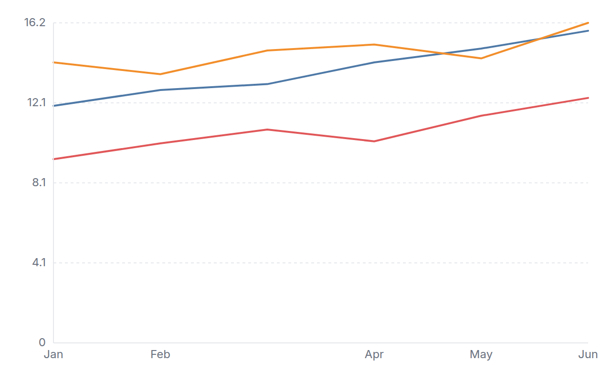
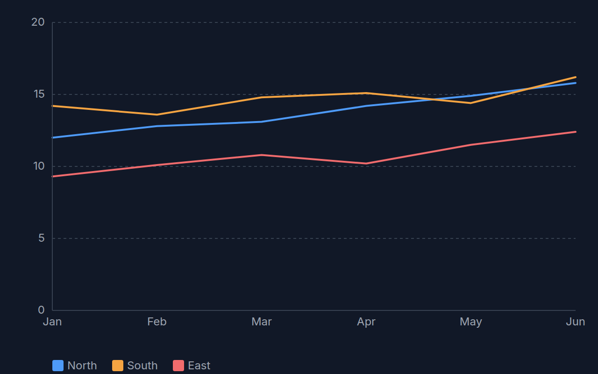

[← Guide](../README.md) | [← Project README](../../../README.md)

# Line chart

One line per series across an ordered set of x categories.

## Contents

- [Overview](#overview)
- [Data shape](#data-shape)
- [Props](#props)
- [Example](#example)
- [Rendered output](#rendered-output)
- [Accessibility](#accessibility)
- [See also](#see-also)

## Overview

| | |
|---|---|
| Component | `LineChart` (from `lumagrid` or `lumagrid/viz`) |
| Plugin id | `line` (`nativeLinePlugin`) |
| Stability | stable (see [STABILITY](../../STABILITY.md)) |

## Data shape

Plain `rows` plus `fields`: a label column for the x category (string or date), a number column for the y value, and optionally a column that names the series. Use long form, one row per category and series. If your data is wide (one column per series), reshape it first with `pivot` or `aggregate` from [Transforms](../transforms.md).

The chart draws categories as evenly spaced points; it is not a time scale. Without `colorField`, the points follow row order and each row is one point. With `colorField`, the distinct label values are placed in the order they first appear in the rows, and each series is sorted along that order. The y axis always includes 0. Rows with a missing value count as 0, and non-finite values are not drawn.

## Props

| Prop | Meaning | When omitted |
|------|---------|--------------|
| `labelField` | column for the x category | the first `string` or `date` column in `data.fields` |
| `valueField` | column for the y value | the first `number` column in `data.fields` |
| `colorField` | column whose distinct values become separate colored lines | one line for all rows |
| `ariaLabel` | accessible name of the chart | `Line chart of <value column>` |

The legacy `xField` and `yField` props are deprecated aliases of `labelField` and `valueField`; they still work, a role name wins over its alias, and both are removed in 2.0.

At most five x tick labels are shown, each cut at 8 characters. There is no legend, so name the series in surrounding text or in `ariaLabel`.

## Example

<!-- snippet: chart-line#line -->

```tsx
import { lightTheme } from 'lumagrid';
import type { TransformedData } from 'lumagrid';
import { LineChart } from 'lumagrid/viz';

// Long form: one row per month and region.
const trend: TransformedData = {
  rows: [
    { month: 'Jan', revenue: 12.0, region: 'North' },
    { month: 'Feb', revenue: 12.8, region: 'North' },
    { month: 'Mar', revenue: 13.1, region: 'North' },
    { month: 'Jan', revenue: 14.2, region: 'South' },
    { month: 'Feb', revenue: 13.6, region: 'South' },
    { month: 'Mar', revenue: 14.8, region: 'South' },
  ],
  fields: [
    { key: 'month', type: 'string' },
    { key: 'revenue', type: 'number' },
    { key: 'region', type: 'string' },
  ],
};

// labelField is the x category, valueField the y value, colorField splits the series.
export function Example() {
  return (
    <LineChart
      data={trend}
      width={600}
      height={300}
      theme={lightTheme}
      labelField="month"
      valueField="revenue"
      colorField="region"
      ariaLabel="Monthly revenue by region"
    />
  );
}
```

As a switchable view:

<!-- snippet: chart-line#line-view -->

```tsx
// The same chart as a ViewSwitcher view: register nativeLinePlugin, then name it by id.
export const lineView = {
  id: 'line',
  label: 'Line chart',
  config: { labelField: 'month', valueField: 'revenue', colorField: 'region' },
};
```

## Rendered output

Light theme:



Dark theme:



Vector versions: [light SVG](../../assets/charts/line-light.svg) and [dark SVG](../../assets/charts/line-dark.svg). The images are generated; see [Chart images](../../assets/charts/README.md).

## Accessibility

The chart is one `<svg>` with `role="img"` and an `aria-label` (your `ariaLabel`, or the default above). Individual points have no tooltips or text alternatives, so put the key numbers in nearby text or offer the [data table](./data-table.md) view of the same rows. Axis text uses theme colors, so contrast follows the theme you pass.

## See also

- [Theming](../theming.md): the `theme` prop and the color scale.
- [Plugins and adapters](../plugins-and-adapters.md): registering `line` and drawing the same data with D3, Recharts or Nivo.
- [Troubleshooting](../troubleshooting.md): a chart that stays empty.
- [All charts](./README.md)
