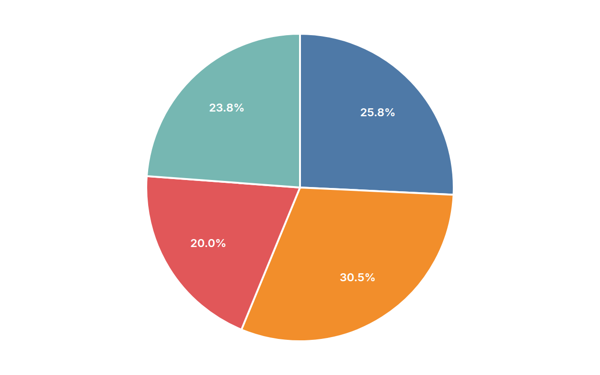
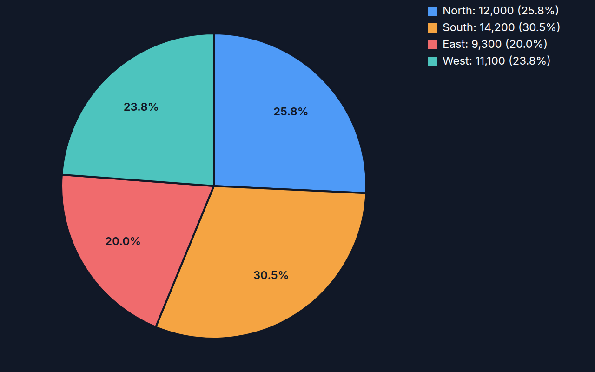

[← Guide](../README.md) | [← Project README](../../../README.md)

# Pie chart

Slices sized by value, with an optional donut hole that shows the total.

## Contents

- [Overview](#overview)
- [Data shape](#data-shape)
- [Props](#props)
- [Example](#example)
- [Rendered output](#rendered-output)
- [Accessibility](#accessibility)
- [See also](#see-also)

## Overview

| | |
|---|---|
| Component | `PieChart` (from `lumagrid` or `lumagrid/viz`); its props type `PieChartProps` is exported too |
| Plugin id | `pie` (`nativePiePlugin`) |
| Stability | stable (see [STABILITY](../../STABILITY.md)) |

## Data shape

Plain `rows` plus `fields`: a string column for the slice label and a number column for the slice size. Rows whose value is 0, negative or not finite are dropped, and the percentages are shares of the remaining total.

## Props

| Prop | Meaning | When omitted |
|------|---------|--------------|
| `valueField` | column that sets the slice size | the first `number` column in `data.fields` |
| `labelField` | column used as the slice name | the first `string` column in `data.fields` |
| `donut` | draw a ring and print the total in the middle | `false` |
| `ariaLabel` | accessible name of the chart | `Pie chart of <value column>` |

The legacy `xField` and `yField` props are deprecated aliases of `labelField` and `valueField`; they still work, a role name wins over its alias, and both are removed in 2.0.

A slice shows its percentage only when it is larger than 4 percent of the total. The slice names themselves appear in the tooltip title, not on the chart, so there is no on-chart legend.

## Example

<!-- snippet: chart-pie#pie -->

```tsx
import { lightTheme } from 'lumagrid';
import type { TransformedData } from 'lumagrid';
import { PieChart } from 'lumagrid/viz';

const sales: TransformedData = {
  rows: [
    { region: 'North', revenue: 12000 },
    { region: 'South', revenue: 14200 },
    { region: 'East', revenue: 9300 },
    { region: 'West', revenue: 11100 },
  ],
  fields: [
    { key: 'region', type: 'string' },
    { key: 'revenue', type: 'number' },
  ],
};

// valueField is the slice size, labelField the slice name. donut adds the total in the middle.
export function Example() {
  return (
    <PieChart
      data={sales}
      width={360}
      height={300}
      theme={lightTheme}
      valueField="revenue"
      labelField="region"
      donut
      ariaLabel="Revenue share by region"
    />
  );
}
```

As a switchable view:

<!-- snippet: chart-pie#pie-view -->

```tsx
// The same chart as a ViewSwitcher view: register nativePiePlugin, then name it by id.
export const pieView = {
  id: 'pie',
  label: 'Pie chart',
  config: { valueField: 'revenue', labelField: 'region', donut: true },
};
```

## Rendered output

Light theme:



Dark theme:



Vector versions: [light SVG](../../assets/charts/pie-light.svg) and [dark SVG](../../assets/charts/pie-dark.svg). The images are generated; see [Chart images](../../assets/charts/README.md).

## Accessibility

The chart is one `<svg>` with `role="img"` and an `aria-label` (your `ariaLabel`, or the default above). Each slice carries a `<title>` with its label, value and percentage. Because names are not drawn on the chart, say what the slices are in `ariaLabel` or in nearby text.

## See also

- [Theming](../theming.md): the `theme` prop and the color scale.
- [Plugins and adapters](../plugins-and-adapters.md): registering `pie` and drawing the same data with D3, Recharts or Nivo.
- [Troubleshooting](../troubleshooting.md): a chart that stays empty.
- [All charts](./README.md)
