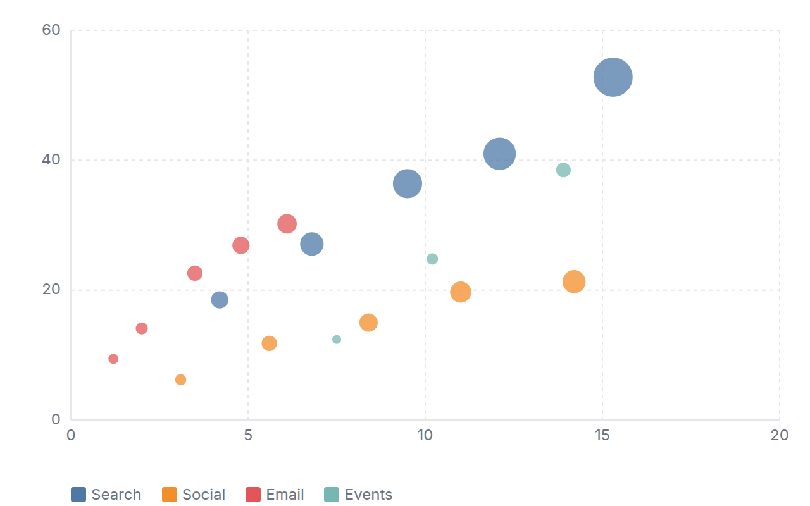
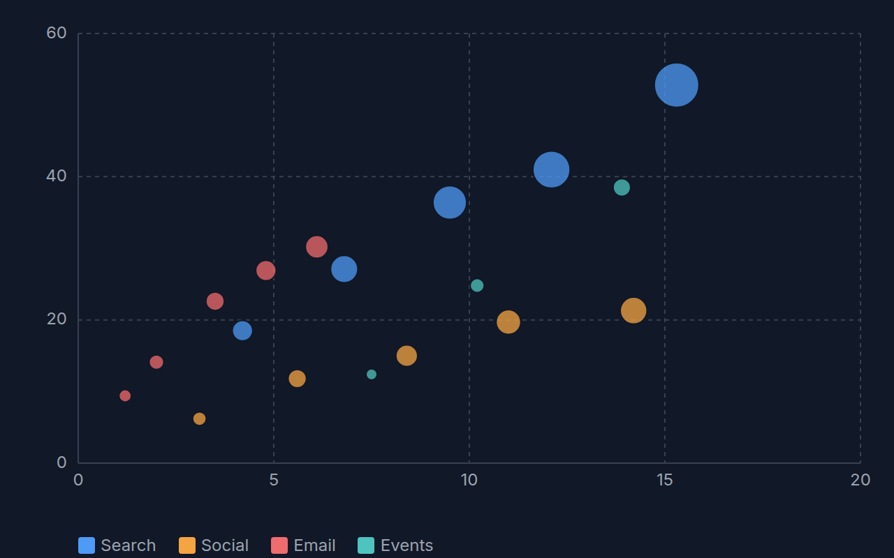

[← Guide](../README.md) | [← Project README](../../../README.md)

# Scatter chart

Points on two numeric axes, optionally colored by series and sized by a third number.

## Contents

- [Overview](#overview)
- [Data shape](#data-shape)
- [Props](#props)
- [Example](#example)
- [Rendered output](#rendered-output)
- [Accessibility](#accessibility)
- [See also](#see-also)

## Overview

| | |
|---|---|
| Component | `ScatterChart` (from `lumagrid` or `lumagrid/viz`) |
| Plugin id | `scatter` (`nativeScatterPlugin`) |
| Stability | stable (see [STABILITY](../../STABILITY.md)) |

## Data shape

Plain `rows` plus `fields` with two number columns: one for x and one for y. Add a string column to split the rows into colored series, and a third number column to turn the points into bubbles. Rows whose x or y is not a finite number are skipped.

Axes use "nice" tick values and are not forced to include 0.

## Props

| Prop | Meaning | When omitted |
|------|---------|--------------|
| `xValueField` | column for the x number | the first `number` column in `data.fields` |
| `valueField` | column for the y number | the next `number` column after the x column |
| `colorField` | column whose distinct values become separate colored series | one series for all rows |
| `sizeField` | number column mapped to point radius | all points have the same radius |
| `showLegend` | render a color legend when `colorField` yields series | `true` |
| `onSelect` | called with the source row when a point is clicked or activated with Enter or Space | no callback |
| `ariaLabel` | accessible name of the chart | `Scatter chart of <y> by <x>` |

The legacy `xField` and `yField` props are accepted as aliases of `xValueField` and `valueField`.

## Example

<!-- snippet: chart-scatter#scatter -->

```tsx
import { lightTheme } from 'lumagrid';
import type { TransformedData } from 'lumagrid';
import { ScatterChart } from 'lumagrid/viz';

// One row per observation: marketing spend and revenue for a channel, with the signups it produced.
const channels: TransformedData = {
  rows: [
    { channel: 'Search', spend: 4.2, revenue: 18.5, signups: 310 },
    { channel: 'Search', spend: 9.5, revenue: 36.4, signups: 620 },
    { channel: 'Social', spend: 5.6, revenue: 11.8, signups: 260 },
    { channel: 'Social', spend: 11.0, revenue: 19.7, signups: 410 },
    { channel: 'Email', spend: 2.0, revenue: 14.1, signups: 175 },
    { channel: 'Email', spend: 4.8, revenue: 26.9, signups: 310 },
  ],
  fields: [
    { key: 'channel', type: 'string' },
    { key: 'spend', type: 'number' },
    { key: 'revenue', type: 'number' },
    { key: 'signups', type: 'number' },
  ],
};

// xValueField is the x number, valueField the y number, colorField splits the series, sizeField sets the bubble radius.
export function Example() {
  return (
    <ScatterChart
      data={channels}
      width={600}
      height={300}
      theme={lightTheme}
      xValueField="spend"
      valueField="revenue"
      colorField="channel"
      sizeField="signups"
      ariaLabel="Revenue against marketing spend by channel"
    />
  );
}
```

As a switchable view:

<!-- snippet: chart-scatter#scatter-view -->

```tsx
// The same chart as a ViewSwitcher view: register nativeScatterPlugin, then name it by id.
export const scatterView = {
  id: 'scatter',
  label: 'Scatter chart',
  config: { xValueField: 'spend', valueField: 'revenue', colorField: 'channel', sizeField: 'signups' },
};
```

## Rendered output

Light theme:



Dark theme:



Vector versions: [light SVG](../../assets/charts/scatter-light.svg) and [dark SVG](../../assets/charts/scatter-dark.svg). The images are generated; see [Chart images](../../assets/charts/README.md).

## Accessibility

The chart is an `<svg>` with `role="group"` and an `aria-label`. Every point is keyboard focusable with a visible focus ring and an `aria-label` of series, x and y, and Enter or Space activates `onSelect`. A visually hidden data table repeats all the rows for screen readers. Series are told apart by color and by the legend, so also name them in surrounding text if color alone could be missed.

## See also

- [Theming](../theming.md): the `theme` prop and the color scale.
- [Plugins and adapters](../plugins-and-adapters.md): registering `scatter` and the conformance kit that checks it.
- [Troubleshooting](../troubleshooting.md): a chart that stays empty.
- [All charts](./README.md)
