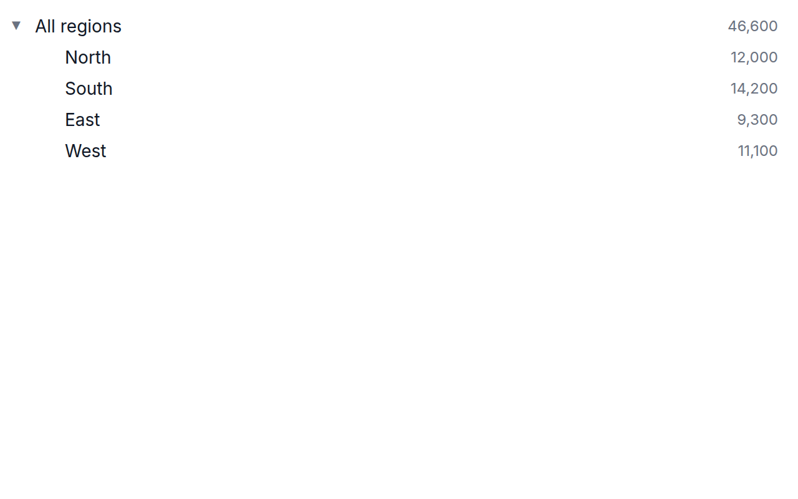
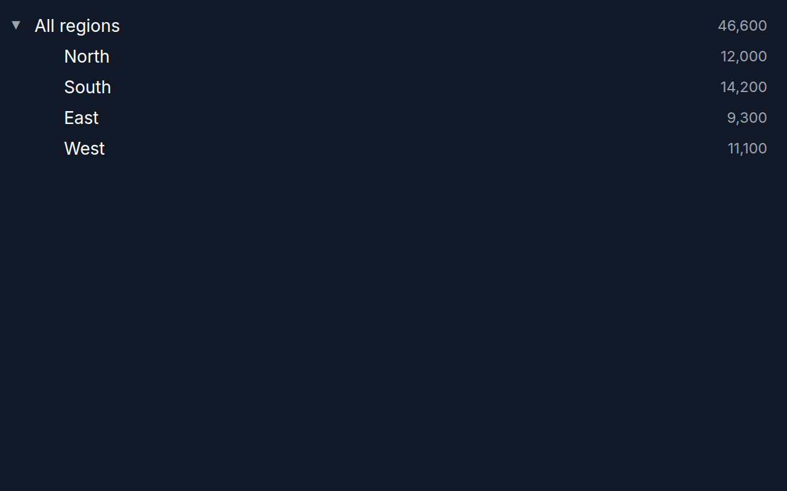

[← Guide](../README.md) | [← Project README](../../../README.md)

# Tree view

A collapsible tree built from a hierarchy.

## Contents

- [Overview](#overview)
- [Data shape](#data-shape)
- [Props](#props)
- [Example](#example)
- [Rendered output](#rendered-output)
- [Accessibility](#accessibility)
- [See also](#see-also)

## Overview

| | |
|---|---|
| Component | `TreeView` (from `lumagrid` or `lumagrid/viz`); its props type `TreeViewProps` is exported too |
| Plugin id | `tree` (`nativeTreePlugin`) |
| Stability | stable (see [STABILITY](../../STABILITY.md)) |

## Data shape

The tree reads `data.hierarchy`, a `HierarchyNode` with an `id`, a `label`, an optional numeric `value` and optional `children`. The `groupBy` transform produces one (a root with one child per distinct value, valued by the summed `valueField` or by the row count). You can also build the object by hand. If `data.hierarchy` is missing, the chart shows the text "TreeView requires a hierarchy. Use the groupBy transform or build a HierarchyNode manually."

## Props

The tree takes no role field props: it ignores `valueField`, `labelField`, `idField` and `colorField`, and the legacy `xField` and `yField` too. It reads only `data.hierarchy`.

| Prop | Meaning | When omitted |
|------|---------|--------------|
| `onSelect` | called with the `HierarchyNode` of a row when it is clicked (leaf rows included) | clicks only expand and collapse |
| `ariaLabel` | accessible name of the tree (`role="tree"` must have one) | `Tree` |
| `height` | height of the scrolling tree area | required |

**It needs a `CollapseManager` above it.** Expand state comes from the nearest `CollapseManager`, and rendering a tree without one throws `useCollapse must be used inside a CollapseManager`. Its `defaultExpanded` prop lists the node ids that start open; by default everything is collapsed, so pass `['root']` (the id `groupBy` gives its root) to show the first level. Clicking a row that has children toggles it. A row shows its `value`, formatted for the viewer's locale, when it has one. Hovering highlights the row.

## Example

<!-- snippet: chart-tree#tree -->

```tsx
import { CollapseManager, groupBy, lightTheme } from 'lumagrid';
import type { HierarchyNode, TransformedData } from 'lumagrid';
import { TreeView } from 'lumagrid/viz';

const orders: TransformedData = {
  rows: [
    { region: 'North', revenue: 7200 },
    { region: 'North', revenue: 4800 },
    { region: 'South', revenue: 8100 },
    { region: 'East', revenue: 5300 },
  ],
  fields: [
    { key: 'region', type: 'string' },
    { key: 'revenue', type: 'number' },
  ],
};

// groupBy attaches a hierarchy: a root with one child per region, valued by summed revenue.
export const grouped = groupBy('region', 'revenue').transform(orders);

export function Example({ onPick }: { onPick?: (node: HierarchyNode) => void }) {
  return (
    // TreeView reads expand state from the nearest CollapseManager; defaultExpanded opens the root.
    <CollapseManager defaultExpanded={['root']}>
      <TreeView
        data={grouped}
        width={360}
        height={240}
        theme={lightTheme}
        {...(onPick ? { onSelect: onPick } : {})}
      />
    </CollapseManager>
  );
}
```

As a switchable view:

<!-- snippet: chart-tree#tree-view -->

```tsx
// The same chart as a ViewSwitcher view: register nativeTreePlugin, wrap the switcher
// in a CollapseManager, then name the view by id. The tree has no role field props.
export const treeView = { id: 'tree', label: 'Tree' };
```

## Rendered output

Light theme:



Dark theme:



Only PNG files exist for this chart. It renders HTML elements rather than an SVG drawing, and the capture deliberately does not wrap HTML in a `foreignObject` (unreliable outside browsers, and extra active content in a committed SVG), so no SVG is produced. The images are generated; see [Chart images](../../assets/charts/README.md).

## Accessibility

The container has `role="tree"` and an `aria-label` (your `ariaLabel`, default `Tree`), and each row has `role="treeitem"` with `aria-expanded` on rows that have children. One row is in the tab order; the arrow keys, Home and End move between rows, and Enter or Space expands, collapses and selects. Text uses theme colors, so contrast follows the theme you pass.

## See also

- [Theming](../theming.md): the `theme` prop and the color scale.
- [Plugins and adapters](../plugins-and-adapters.md): registering `tree` and drawing the same data with D3, Recharts or Nivo.
- [Troubleshooting](../troubleshooting.md): a chart that stays empty.
- [All charts](./README.md)
